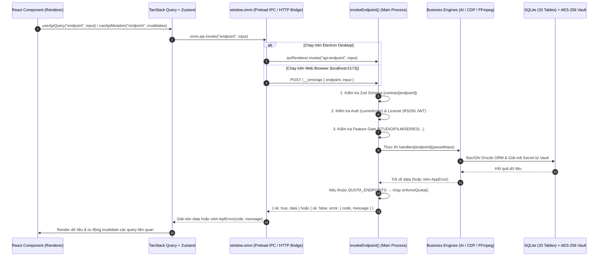

# TÀI LIỆU KIẾN TRÚC HỆ THỐNG & DỊCH NGƯỢC MÃ NGUỒN (PROJECT ARCHITECTURE & REVERSE ENGINEERING SPECIFICATION)

- **Tên sản phẩm:** Omnira Studio (tên định danh nội bộ: `omnira-studio` / `com.omnipage.studio`)
- **Phiên bản:** `1.2.7`
- **Mô tả hệ thống:** Nền tảng quản lý, sản xuất nội dung AI đa phương tiện (Video Studio, AI Film Studio, AI Series, AI Image Studio, Multi-Speaker TTS Studio, Virtual Try-On Fashion) & tự động hóa phân phối, tương tác đa kênh mạng xã hội (Facebook, Instagram, TikTok, YouTube) trên Desktop & Web Local.
- ** Kiến trúc vận hành:** Hybrid Desktop Application (Electron 35+ Main/Preload/Renderer + Local HTTP/SSE Bridge Server trên cổng `5173` + Embedded Python VieNeu-TTS Server + Anti-Detect Chromium CDP Automation).

---

## PHẦN 1: TỔNG QUAN & STACK CÔNG NGHỆ (TECHNOLOGY STACK & DIRECTORY TREE)

### 1.1. Ngôn ngữ, Framework & Các thư viện cốt lõi

Dựa trên [`my app/package.json`](file:///c:/Users/nminh/Desktop/aaaaaaaaaaaaaaaaaaaaaaa/my%20app/package.json), [`out/main/index.js`](file:///c:/Users/nminh/Desktop/aaaaaaaaaaaaaaaaaaaaaaa/my%20app/out/main/index.js) và [`out/renderer/assets/index-01dFNdzs.js`](file:///c:/Users/nminh/Desktop/aaaaaaaaaaaaaaaaaaaaaaa/my%20app/out/renderer/assets/index-01dFNdzs.js), hệ thống được xây dựng trên bộ stack hiện đại:

#### A. Nền tảng Runtime & Build Tooling
| Thành phần | Công nghệ / Phiên bản | Vai trò trong hệ thống |
| :--- | :--- | :--- |
| **Desktop Runtime** | **Electron** (`runtime/Omnira Studio.exe`) | Quản lý vòng đời ứng dụng, cửa sổ frameless, System Tray, `safeStorage` (DPAPI/Keychain), giao thức nội bộ `omni-media://`, IPC Bridge. |
| **Build / Bundler** | **electron-vite** (Vite + Rollup) | Đóng gói tách biệt 3 môi trường: `out/main/index.js` (CommonJS, 23,011 dòng), `out/preload/index.js` (CommonJS, 61 dòng), `out/renderer/` (ESM bundle, 57,035 dòng + CSS 4,198 dòng). |
| **Ngôn ngữ gốc** | **TypeScript / JavaScript (ES2022+)** + **SQL** + **Python 3.11** | Toàn bộ Main/Renderer viết bằng TypeScript (compile sang JS giữ nguyên tên hàm/biến), schema SQLite quản lý bằng SQL migrations, và nhúng script Python (`ENGINE_SCRIPT`) cho Local TTS. |
| **Dual Runtime Mode** | **Electron Native IPC** & **HTTP/SSE Local Server (`127.0.0.1:5173`)** | Cho phép chạy như ứng dụng Desktop truyền thống (`run-local.bat`) hoặc chạy ngầm (`--hidden --open-http` qua `run-http.bat`) phát giao diện Web SPA ra trình duyệt ngoài qua `omni-http-bridge.js`. |

#### B. Frontend (Renderer Process)
| Thư viện | Phiên bản (`package.json`) | Vai trò cốt lõi |
| :--- | :--- | :--- |
| `react` / `react-dom` | `^18.3.1` | Thư viện UI cốt lõi sử dụng Concurrent Mode, `StrictMode`, Custom Hooks. |
| `react-router-dom` | `^6.30.6` | Điều hướng SPA phía client thông qua `HashRouter`, `Routes`, `Route`, `Outlet`, `NavLink`. |
| `@tanstack/react-query` | `^5.104.0` | Quản lý Server/IPC State, caching (`staleTime: 30s`), polling đồng bộ tiến trình nền, tự động invalidate theo prefix namespace. |
| `zustand` | `^5.0.15` | Quản lý Client State toàn cục (`useUiStore` lưu `localStorage["omni-ui"]`, `useSystemStore`, `useToastStore`, `useConfirmStore`). |
| `framer-motion` | `^13.4.6` | Hoạt ảnh chuyển cảnh cho `Dialog`, `Drawer`, `Toaster`, `SegmentedControl`, và hiệu ứng theo chủ đề. |
| `@dnd-kit/core` / `sortable` / `utilities` | `^6.3.1` / `^10.0.0` / `^3.2.2` | Kéo thả (Drag & Drop) phân cảnh video (`Storyboard`), danh sách cảnh phim (`AssetBoard`), và kéo thả bài đăng vào lịch (`CalendarPage`). |
| `lucide-react` | `^1.49.0` | Bộ icon vector xuyên suốt toàn bộ giao diện. |
| `Tailwind CSS v3` + `tailwind-merge` + `clsx` | `^3.7.0` / `^2.1.1` | Hệ thống styling utility-first kết hợp biến màu động RGB (`--c-*`) và cấu hình custom `twMerge` (`cn()`). |
| `@fontsource-variable/*` & `@fontsource/montserrat` | `^5.3.0` | Bộ tứ font chữ tự host (offline-first): `Inter Variable`, `JetBrains Mono Variable`, `Space Grotesk Variable`, `Montserrat` (900 Black). |

#### C. Backend & Core Engines (Main Process)
| Thư viện | Phiên bản (`package.json`) | Vai trò cốt lõi |
| :--- | :--- | :--- |
| `better-sqlite3` | `^11.10.0` | Cơ sở dữ liệu SQLite nhúng hiệu năng cao chạy chế độ `WAL` (`journal_mode = WAL`, `foreign_keys = ON`, `busy_timeout = 5000`). |
| `drizzle-orm` | `^0.44.7` | Type-safe ORM và bộ chạy migration tự động (`drizzle-orm/better-sqlite3/migrator`) với 39 bản migration (`0000` → `0038`). |
| `zod` | `^3.25.76` | Xác thực dữ liệu đầu vào (input validation) cho toàn bộ **268 RPC endpoints**, ép kiểu JSON trả về từ AI (`aiJson`), và kiểm tra cấu hình. |
| `patchright-core` | `1.63.0` | Bản fork chống phát hiện bot (anti-detect Playwright) kết nối qua giao thức CDP (`connectOverCDP`) tới Chrome/Edge thật trên máy để tự động hóa **Google Labs Flow (Veo 3.1 / Nano Banana)**, **Meta Muse AI**, **Grok Imagine**, và lấy cookie đăng nhập MXH. |
| `ffmpeg-static` / `ffprobe-static` | `^5.3.0` / `^3.1.0` | Xử lý hậu kỳ video/audio đa luồng: dò tìm GPU encoder (`h264_nvenc`, `h264_videotoolbox`, `h264_amf`, `h264_qsv`, `libx264`), hiệu ứng Ken Burns (`zoompan`), đốt phụ đề Karaoke ASS (`Montserrat-Black.ttf`), ghép cảnh (`xfade`), trộn nhạc nền (`sidechaincompress` audio ducking), chèn watermark, và upscale 1080p/4K. |
| `@anthropic-ai/sdk` | `^0.131.0` | SDK gọi Claude (`claude-sonnet-4-6`) cùng các HTTP client tích hợp cho OpenAI, Gemini, DeepSeek, Fal.ai, ElevenLabs, CometAPI, PiAPI, Pexels, Pixabay. |
| `msedge-tts` | `^2.0.8` | Tổng hợp giọng nói tiếng Việt & đa ngôn ngữ miễn phí qua Microsoft Edge Neural TTS (`vi-VN-HoaiMyNeural`, `vi-VN-NamMinhNeural`,...). |
| **VieNeu-TTS (Embedded Python)** | `vieneu==3.8.3` + `uv 0.6.14` | Engine TTS & Voice Cloning tiếng Việt chạy cục bộ (offline GPU CUDA 12.8 / CPU) qua model `VieNeu-TTS-0.3B-q4-gguf` được cài đặt tự động vào `userData/local-tts`. |

---

### 1.2. Sơ đồ cây thư mục chính & Vai trò từng Module

```text
c:\Users\nminh\Desktop\aaaaaaaaaaaaaaaaaaaaaaa\
├── run-local.bat                         # Script khởi chạy Omnira Studio chế độ cửa sổ Desktop từ runtime\Omnira Studio.exe
├── run-http.bat                          # Script khởi chạy Omnira Studio ẩn (--hidden --open-http) mở Web UI tại http://localhost:5173
├── my app\                               # Thư mục mã nguồn ứng dụng đã đóng gói (Application Bundle)
│   ├── package.json                      # Khai báo metadata (v1.2.7), entry point (./out/main/index.js) và 24 dependencies cốt lõi
│   ├── drizzle\                          # Toàn bộ lịch sử tiến hóa Schema SQLite (39 migrations từ 0000 đến 0038)
│   │   ├── 0000_init.sql                 # Khởi tạo 20 bảng nền tảng (workspaces, accounts, channels, secrets, video_projects,...)
│   │   ├── 0001..0016_*.sql              # Mở rộng AI Router, Media Engine, Publishing, Inbox Sync, Series, Plan, Acts, Early Reach
│   │   ├── 0017..0026_film_*.sql         # Hệ thống AI Film Studio, Series-Film Link, Character Voice, Channel Quota, Upscale
│   │   ├── 0027..0036_*.sql              # Content Hook Score, Virtual Try-On Fashion, Image Studio, Perf Indexes, Film Chain Shots
│   │   ├── 0037..0038_tts_*.sql          # Hệ thống Multi-Speaker TTS Studio (`tts_jobs`), Voice Cast & xuất phụ đề SRT
│   │   └── meta\                         # `_journal.json` và 38 file snapshot JSON của Drizzle ORM
│   ├── resources\                        # Tài nguyên tĩnh đi kèm ứng dụng
│   │   ├── icon.png                      # Biểu tượng ứng dụng Omnira Studio (186 KB)
│   │   └── fonts\
│   │       ├── Montserrat-Black.ttf      # Font chữ dùng cho FFmpeg libass đốt phụ đề Karaoke & tiêu đề ảnh Image Studio
│   │       └── OFL-Montserrat.txt        # Giấy phép font chữ
│   ├── out\                              # Mã nguồn thực thi chia làm 3 tầng kiến trúc của Electron
│   │   ├── main\
│   │   │   └── index.js                  # [23,011 dòng] Toàn bộ Backend Main Process: DB, Vault, Cloud Auth/License, AI Router,
│   │   │                                 #   CDP Browser Automation (Flow/Muse/Grok), FFmpeg Media Engine, 5 Workers, 268 RPC APIs
│   │   ├── preload\
│   │   │   └── index.js                  # [61 dòng] ContextBridge an toàn gắn `window.omni` cho Renderer giao tiếp qua IPC
│   │   └── renderer\
│   │       ├── index.html                # Entry HTML cấu hình CSP (`omni-media:`, `blob:`, `data:`) và nạp Bridge + React bundle
│   │       ├── omni-http-bridge.js       # [146 dòng] Polyfill `window.omni` khi chạy trên trình duyệt Web qua HTTP + SSE `/__omni/*`
│   │       └── assets\
│   │           ├── index-01dFNdzs.js     # [57,035 dòng] Toàn bộ giao diện React 18, Zustand stores, TanStack Query, 18 Pages
│   │           ├── index-D9-rggfQ.css    # [4,198 dòng] Design System "Fluent Command Suite" (Dark / Light / Halloween)
│   │           ├── zalo-join-CObQNn89.png# Mã QR nhóm Zalo cộng đồng / hỗ trợ Omnira
│   │           └── *.woff2 / *.woff      # 25 file font chữ cục bộ (Inter, JetBrains Mono, Montserrat, Space Grotesk)
│   └── node_modules\                     # Các thư viện runtime (bao gồm native addon `better-sqlite3`, `ffmpeg-static`, `patchright-core`)
└── runtime\                              # Bản đóng gói Electron Runtime thực thi trên Windows
    ├── Omnira Studio.exe                 # Binary thực thi chính của Electron
    ├── ffmpeg.dll / libEGL.dll / ...     # Thư viện đồ họa & giải mã đa phương tiện của Chromium
    └── resources\
        ├── app\                          # Bản sao đồng bộ của thư mục `my app\` được nạp bởi `Omnira Studio.exe`
        ├── drizzle\                      # Các bản migration SQL dự phòng ở cấp `process.resourcesPath`
        └── fonts\Montserrat-Black.ttf    # Font chữ dự phòng ở cấp `process.resourcesPath`
```

#### Sơ đồ cấu trúc lưu trữ dữ liệu người dùng trên ổ cứng (`userData` / `dataRoot`)
Ngoài thư mục mã nguồn, ứng dụng thiết lập một kiến trúc lưu trữ đa người dùng (Multi-User Isolated Storage) tại `app.getPath("userData")` (hoặc thư mục tùy chỉnh qua `userData/data-location.json` — xem [`out/main/index.js:1422-1471`](file:///c:/Users/nminh/Desktop/aaaaaaaaaaaaaaaaaaaaaaa/my%20app/out/main/index.js#L1422-L1471)):

```text
<dataRoot>/ (Mặc định: %APPDATA%\omnira-studio\)
├── omnipage-data.json                    # File đánh dấu thư mục dữ liệu hợp lệ (DATA_MARKER)
├── ui-theme.json                         # Lưu theme hiện tại ("dark" | "light" | "halloween" | "system")
├── background.json                       # Cấu hình chạy ngầm System Tray ({ closeToTray, hintShown })
├── logs\
│   └── main.log (.1, .2, .3)             # Nhật ký hệ thống tự động xoay vòng (5MB/file, giữ tối đa 3 bản cũ, UTF-8 BOM)
├── local-tts\                            # Môi trường Python độc lập cho VieNeu-TTS (cài đặt tự động)
│   ├── uv\ & python\ & venv\             # Astral uv 0.6.14 + CPython 3.11 + PyTorch (CUDA 12.8 / CPU) + vieneu==3.8.3
│   ├── hf\                               # Cache model HuggingFace (`VieNeu-TTS-0.3B-q4-gguf`)
│   └── engine.py & installed.json        # HTTP FastAPI/BaseHTTPServer nội bộ phục vụ TTS & Voice Cloning
├── auth\                                 # Dữ liệu định danh thiết bị & phiên đăng nhập toàn cục
│   ├── device.json                       # Định danh thiết bị duy nhất: { deviceId: "omn-<40_hex>", createdAt }
│   ├── users.json                        # Danh sách tài khoản đã đăng nhập trên máy
│   ├── session.bin                       # Token phiên hoạt động được mã hóa qua OS `safeStorage`
│   └── cloud-<userId>.bin                # Token Cloud, Refresh Token, RS256 License JWT & Managed API Keys (mã hóa `safeStorage`)
└── users\
    └── <userId>\                         # Cô lập hoàn toàn dữ liệu theo từng tài khoản Omnira
        ├── data\
        │   └── omnipage.db (-wal, -shm)  # Cơ sở dữ liệu SQLite 33 bảng của riêng người dùng
        ├── vault\
        │   ├── master.bin                # Khóa chủ AES-256-GCM (32 bytes) mã hóa bằng OS `safeStorage` (DPAPI/Keychain)
        │   └── master.portable           # Khóa chủ dự phòng mã hóa bằng `scrypt(password)` + AES-256-GCM để di chuyển dữ liệu sang máy khác
        ├── flow-chrome\                  # Profile Chrome cô lập cho Google Labs Flow (Veo 3.1 / Nano Banana)
        ├── muse-chrome\                  # Profile Chrome cô lập cho Meta Muse AI
        ├── grok-chrome\                  # Profile Chrome cô lập cho Grok Imagine
        └── media\                        # Kho lưu trữ tài nguyên đa phương tiện cục bộ (phục vụ qua `omni-media://local/...`)
            ├── uploads\                  # Ảnh/video tải lên & video đã upscale
            ├── renders\                  # Video xuất bản hoàn chỉnh từ Video Studio (`<projectId>-<jobId>.mp4`)
            ├── segments\<projectId>\     # Cache từng phân cảnh video đã render (`<hash>.mp4`) và phụ đề (`<sceneId>.ass`)
            ├── film\<filmId>\            # Toàn bộ takes ảnh/video, thuyết minh, watermark và bản ghép của Xưởng Phim AI
            ├── series\<seriesId>\        # Ảnh thiết kế nhân vật chuẩn (Character Turnaround Sheets)
            ├── imagestudio\<projectId>\  # Ảnh gốc (`.raw.png`) và ảnh đã đóng chữ của Xưởng Ảnh AI
            ├── tts\<jobId>\              # Các phân đoạn âm thanh (`parts/*.wav`), bản ghép `audio.mp3` và phụ đề `audio.srt`
            ├── cache\ai\ & cache\stock\  # Cache ảnh/video AI, sidecar `.flow.json`, stock Pexels/Pixabay, cache TTS/STS
            ├── bgm\                      # Nhạc nền `.mp3/.wav/.m4a`
            └── voice-samples\ & voice-clones\ # Mẫu giọng nói ghi âm/tải lên (3-15s) cho VieNeu-TTS Voice Cloning
```

---

## PHẦN 2: CẤU TRÚC GIAO DIỆN & ĐIỀU HƯỚNG (UI/UX ARCHITECTURE)

### 2.1. Luồng điều hướng (Routing / Navigation Flow)

Toàn bộ giao diện Renderer được khởi tạo tại [`out/renderer/assets/index-01dFNdzs.js:56998-57035`](file:///c:/Users/nminh/Desktop/aaaaaaaaaaaaaaaaaaaaaaa/my%20app/out/renderer/assets/index-01dFNdzs.js#L56998-L57035). Hệ thống sử dụng `HashRouter` của React Router v6, được bảo vệ bởi 2 lớp cổng kiểm soát là [`AuthGate`](file:///c:/Users/nminh/Desktop/aaaaaaaaaaaaaaaaaaaaaaa/my%20app/out/renderer/assets/index-01dFNdzs.js#L56433-L56473) (xác thực người dùng, bắt buộc cập nhật phiên bản tối thiểu, và kiểm tra hiệu lực gói cước/thiết bị) và [`FeatureGate`](file:///c:/Users/nminh/Desktop/aaaaaaaaaaaaaaaaaaaaaaa/my%20app/out/renderer/assets/index-01dFNdzs.js#L29214-L29260) (kiểm tra quyền truy cập tính năng theo gói License).

#### Sơ đồ luồng điều hướng tổng thể (Navigation Flow Diagram)

```mermaid
flowchart TD
    Start(["Khởi động ứng dụng (index.html)"]) --> Bridge{"Môi trường chạy?"}
    Bridge -->|Electron Desktop| Preload["out/preload/index.js (window.omni qua IPC)"]
    Bridge -->|Web Browser :5173| HttpBridge["omni-http-bridge.js (window.omni qua REST + SSE)"]
    
    Preload --> Root["React Root + QueryClientProvider + App()"]
    HttpBridge --> Root

    Root --> AuthGate{"1. AuthGate (auth.state & cloud.appInfo)"}
    AuthGate -->|Chưa đăng nhập| LoginPage["LoginPage (Đăng nhập / Đăng ký / OTP / Quên MK)"]
    AuthGate -->|Bắt buộc cập nhật| UpdateRequired["UpdateRequired (Tải & Cài đặt bản mới)"]
    AuthGate -->|Chưa có gói / Quá thiết bị / Hết hạn| LicenseGate["LicenseGate (Mua gói VietQR / Gỡ thiết bị / Kích hoạt Key)"]
    
    AuthGate -->|Hợp lệ (license.usable == true)| AppShell["AppShell (TitleBar + NavRail + StatusBar + CommandPalette)"]

    subgraph Routes ["Hệ thống 18 Routes trong HashRouter"]
        direction TB
        subgraph GroupOverview ["Nhóm 1: Tổng quan & Hạ tầng"]
            R_Dash["/ → DashboardPage (Tổng quan)"]
            R_WS["/workspaces → WorkspacesPage (Không gian / Pockets)"]
            R_Acc["/accounts → AccountsPage (Tài khoản & Kênh MXH)"]
        end

        subgraph GroupProd ["Nhóm 2: Sản xuất Nội dung AI"]
            R_Plan["/plan → PlanPage (Kế hoạch AI 14 ngày)"]
            R_Content["/content → ContentPage (Kho nội dung & Hook Score)"]
            R_Series["/series → FeatureGate(SERIES) → SeriesPage (Series AI)"]
            R_Studio["/studio → FeatureGate(STUDIO) → StudioPage (Xưởng Video AI)"]
            R_Img["/image-studio → FeatureGate(STUDIO) → ImageStudioPage (Xưởng Ảnh AI)"]
            R_Tts["/tts → FeatureGate(STUDIO) → TtsPage (Đọc văn bản Multi-Speaker)"]
            R_Film["/film & /film/:id → FeatureGate(FILM) → FilmPage (Xưởng Phim AI)"]
        end

        subgraph GroupDist ["Nhóm 3: Phân phối & Tương tác"]
            R_Cal["/calendar → FeatureGate(CALENDAR) → CalendarPage (Lịch đăng)"]
            R_Inbox["/inbox → FeatureGate(INBOX) → InboxPage (Hộp thư & AI Auto-Reply)"]
        end

        subgraph GroupSys ["Nhóm 4: Phân tích & Hệ thống"]
            R_Ana["/analytics → FeatureGate(ANALYTICS) → AnalyticsPage (Số liệu)"]
            R_Set["/settings → SettingsPage (Cài đặt AI / Video / Hệ thống)"]
            R_Bill["/billing → BillingPage (Gói cước, VietQR & Giới thiệu)"]
            R_Sup["/support → SupportPage (Ticket Hỗ trợ kỹ thuật)"]
            R_Guide["/guide → GuidePage (Hướng dẫn kết nối đa kênh)"]
        end
    end

    AppShell --> GroupOverview
    AppShell --> GroupProd
    AppShell --> GroupDist
    AppShell --> GroupSys

    %% Liên kết chuyển trang nghiệp vụ nội bộ
    R_Plan -.->|"plan.toVideo → /studio?project=<id>"| R_Studio
    R_Plan -.->|"plan.toImage → /image-studio?project=<id>"| R_Img
    R_Plan -.->|"plan.toPost → /content"| R_Content
    R_Series -.->|"series.writeEpisode → /studio?project=<id>"| R_Studio
    R_Series -.->|"series.makeFilm → /film/<filmId>"| R_Film
    R_Studio -.->|"studio.toContent → /content hoặc ScheduleDialog"| R_Content
    R_Img -.->|"imagestudio.toContent → /content"| R_Content
    R_Film -.->|"film.renderToContent → /content"| R_Content
    R_Content -.->|"ScheduleDialog → /calendar"| R_Cal
```

#### Cơ chế chuyển trang (Navigation Mechanisms)
1. **Sidebar Navigation (`NavRail` - [`L28038-28133`](file:///c:/Users/nminh/Desktop/aaaaaaaaaaaaaaaaaaaaaaa/my%20app/out/renderer/assets/index-01dFNdzs.js#L28038-L28133)):** Thanh điều hướng bên trái chia làm 4 nhóm (*Tổng quan*, *Sản xuất*, *Phân phối*, *Phân tích*), có thể thu gọn (`52px`) hoặc mở rộng (`240px`) bằng phím tắt `Ctrl/Cmd + B`. Hiển thị badge thời gian thực cho số tài khoản lỗi (`summary.accountsWithErrors`), số bài chờ đăng hôm nay (`summary.queuedToday`), và số tin nhắn chưa đọc (`inbox.unreadCount`).
2. **Command Palette (`CommandPalette` - [`L27909-27967`](file:///c:/Users/nminh/Desktop/aaaaaaaaaaaaaaaaaaaaaaa/my%20app/out/renderer/assets/index-01dFNdzs.js#L27909-L27967)):** Mở bằng `Ctrl/Cmd + K`, cho phép tìm kiếm mờ (fuzzy filter) tất cả 17 màn hình và các hành động nhanh (Tạo dự án video, Tạo bài đăng, Đồng bộ hộp thư,...).
3. **Phím tắt điều hướng nhanh (`SHORTCUT_ROUTES` - [`L27996-28006`](file:///c:/Users/nminh/Desktop/aaaaaaaaaaaaaaaaaaaaaaa/my%20app/out/renderer/assets/index-01dFNdzs.js#L27996-L28006)):** Bấm `Ctrl/Cmd + 1..9` để nhảy tức thì tới 9 màn hình chính (`/`, `/workspaces`, `/accounts`, `/content`, `/studio`, `/calendar`, `/inbox`, `/analytics`, `/settings`).
4. **Chuyển trang liên thông theo ngữ cảnh (Cross-Module Deep Linking):**
   - Từ `PlanPage` chuyển ý tưởng thành dự án Video (`/studio?project=<id>`), dự án Ảnh (`/image-studio?project=<id>`), hoặc bài nháp (`/content`).
   - Từ `SeriesPage` chuyển tập phim sang Xưởng Video (`/studio?project=<id>`) hoặc Xưởng Phim AI (`/film/<filmId>`).
   - Từ `SettingsPage` điều hướng theo query string `?tab=ai|publish|video|system` và từ `GuidePage` theo `?tab=facebook|instagram|tiktok|youtube`.
5. **Điều hướng từ Tiến trình chính (`app:navigate` - [`L29816-29818`](file:///c:/Users/nminh/Desktop/aaaaaaaaaaaaaaaaaaaaaaa/my%20app/out/renderer/assets/index-01dFNdzs.js#L29816-L29818)):** Khi người dùng bấm vào thông báo đẩy của hệ điều hành (OS Notification khi có tin nhắn mới hoặc cảnh báo bài đăng bị bóp tương tác), Main Process phát sự kiện `IpcChannel.AppNavigate` đưa người dùng tới `/inbox` hoặc `/`.

---

### 2.2. Cây Component (Component Hierarchy)

Hệ thống UI được kiến trúc theo mô hình phân층 rõ ràng: **Security/Lifecycle Gates → AppShell Layout → Shared UI Primitives → Feature Page Trees**.

```text
<QueryClientProvider client={queryClient}>
  └── <App> (L56998)
        ├── useThemeSync() (Đồng bộ theme Dark / Light / Halloween)
        └── <AuthGate> (L56433)
              ├── [Khi chưa đăng nhập] <LoginPage> (L55749)
              │     ├── <VerifyEmailStep> (L56081)
              │     ├── <ForgotPasswordStep> (L55951)
              │     └── <DataFolderLink> (L56189)
              ├── [Khi cần cập nhật] <UpdateRequired> (L56302)
              ├── [Khi chưa có license] <LicenseGate> (L56341)
              │     ├── <PlanCard> (L29395) & <BuyPlanDialog> (L29531) → <OrderPayment> (L29465)
              │     └── <DevicesList> (L56215)
              └── [Khi đã xác thực & có license] <HashRouter>
                    └── <AppShell> (L29808)
                          ├── <HalloweenAmbience> (L28260) & <Spiders> (L28322)
                          ├── <TitleBar> (L29055)
                          │     ├── <WorkspaceSwitcher> (L28940)
                          │     ├── <FlowCredits> (L28755)
                          │     ├── <RefreshLicenseButton> (L29036)
                          │     ├── <NotificationBell> (L28795)
                          │     ├── <HalloweenOptions> (L28269) & <ThemePicker> (L28214)
                          │     ├── <AccountMenu> (L28640) → <ChangePasswordDialog> (L28593)
                          │     └── <WindowControls> (L28913)
                          ├── <CloudBanner> (L29092 - Thông báo hệ thống & Tiến trình tải bản cập nhật)
                          ├── <QuotaBar> (L29780) → <QuotaPicker> (L29684 - Chọn kênh hoạt động khi vượt hạn mức)
                          ├── <NavRail> (L28038 - Sidebar 4 nhóm, 17 mục)
                          ├── <main>
                          │     ├── <PromoBanner> (L29298 - Đếm ngược khuyến mãi)
                          │     └── <Outlet /> (Render 1 trong 17 màn hình chính; bọc bởi <FeatureGate> nếu cần)
                          ├── <StatusBar> (L28137 - Pocket, Render Queue, GPU Encoder, Chi phí AI, CPU/RAM)
                          ├── <CommandPalette> (L27909)
                          ├── <Toaster> (L27645)
                          └── <ConfirmHost> (L27338)
```

#### Danh mục Shared Components (UI Kit nội bộ)
Thay vì phụ thuộc vào thư viện nặng bên ngoài, Omnira Studio tự xây dựng bộ **Fluent Command Suite UI Kit** đồng nhất tại [`index-01dFNdzs.js:18871-18967`](file:///c:/Users/nminh/Desktop/aaaaaaaaaaaaaaaaaaaaaaa/my%20app/out/renderer/assets/index-01dFNdzs.js#L18871-L18967) và [`27243-27667`](file:///c:/Users/nminh/Desktop/aaaaaaaaaaaaaaaaaaaaaaa/my%20app/out/renderer/assets/index-01dFNdzs.js#L27243-L27667):
- **Containers & Overlays:** [`Card` / `CardHeader`](file:///c:/Users/nminh/Desktop/aaaaaaaaaaaaaaaaaaaaaaa/my%20app/out/renderer/assets/index-01dFNdzs.js#L18947-L18967) (`.omni-card`), [`Dialog`](file:///c:/Users/nminh/Desktop/aaaaaaaaaaaaaaaaaaaaaaa/my%20app/out/renderer/assets/index-01dFNdzs.js#L27262-L27327) (Framer Motion modal hỗ trợ phím `Escape`), [`Drawer`](file:///c:/Users/nminh/Desktop/aaaaaaaaaaaaaaaaaaaaaaa/my%20app/out/renderer/assets/index-01dFNdzs.js#L27360-L27396) (Slide-over panel bên phải), [`ConfirmHost`](file:///c:/Users/nminh/Desktop/aaaaaaaaaaaaaaaaaaaaaaa/my%20app/out/renderer/assets/index-01dFNdzs.js#L27328-L27359) (hộp thoại xác nhận bất đồng bộ trả về `Promise<boolean>`), [`ImageZoomDialog` / `ZoomButton`](file:///c:/Users/nminh/Desktop/aaaaaaaaaaaaaaaaaaaaaaa/my%20app/out/renderer/assets/index-01dFNdzs.js#L29214-L29260) (Lightbox phóng to ảnh).
- **Controls & Inputs:** [`Button`](file:///c:/Users/nminh/Desktop/aaaaaaaaaaaaaaaaaaaaaaa/my%20app/out/renderer/assets/index-01dFNdzs.js#L18929-L18946) (4 variants: `primary`, `secondary`, `subtle`, `danger`; 2 sizes: `sm`, `md`), [`IconButton`](file:///c:/Users/nminh/Desktop/aaaaaaaaaaaaaaaaaaaaaaa/my%20app/out/renderer/assets/index-01dFNdzs.js#L27243-L27261), [`Input` / `Textarea` / `Select` / `Field`](file:///c:/Users/nminh/Desktop/aaaaaaaaaaaaaaaaaaaaaaa/my%20app/out/renderer/assets/index-01dFNdzs.js#L27397-L27424) (tự động gắn `useId()` cho `label`, hiển thị `hint` và `error`), [`Switch`](file:///c:/Users/nminh/Desktop/aaaaaaaaaaaaaaaaaaaaaaa/my%20app/out/renderer/assets/index-01dFNdzs.js#L27425-L27455), [`SegmentedControl`](file:///c:/Users/nminh/Desktop/aaaaaaaaaaaaaaaaaaaaaaa/my%20app/out/renderer/assets/index-01dFNdzs.js#L27587-L27609).
- **Data Display & Feedback:** [`Badge`](file:///c:/Users/nminh/Desktop/aaaaaaaaaaaaaaaaaaaaaaa/my%20app/out/renderer/assets/index-01dFNdzs.js#L18904-L18918) (6 tones), [`KpiTile`](file:///c:/Users/nminh/Desktop/aaaaaaaaaaaaaaaaaaaaaaa/my%20app/out/renderer/assets/index-01dFNdzs.js#L27468-L27487), [`PlatformIcon` / `PlatformBadge`](file:///c:/Users/nminh/Desktop/aaaaaaaaaaaaaaaaaaaaaaa/my%20app/out/renderer/assets/index-01dFNdzs.js#L27488-L27562) (Facebook, TikTok, Instagram, YouTube), [`StatusDot`](file:///c:/Users/nminh/Desktop/aaaaaaaaaaaaaaaaaaaaaaa/my%20app/out/renderer/assets/index-01dFNdzs.js#L27610-L27629) (chấm trạng thái kèm xung nhịp `.animate-halo`), [`Progress`](file:///c:/Users/nminh/Desktop/aaaaaaaaaaaaaaaaaaaaaaa/my%20app/out/renderer/assets/index-01dFNdzs.js#L27563-L27586), [`Kbd`](file:///c:/Users/nminh/Desktop/aaaaaaaaaaaaaaaaaaaaaaa/my%20app/out/renderer/assets/index-01dFNdzs.js#L27456-L27467), [`LineChart`](file:///c:/Users/nminh/Desktop/aaaaaaaaaaaaaaaaaaaaaaa/my%20app/out/renderer/assets/index-01dFNdzs.js#L37007-L37137) (biểu đồ SVG đa chuỗi tự co giãn qua `ResizeObserver`), [`Toaster`](file:///c:/Users/nminh/Desktop/aaaaaaaaaaaaaaaaaaaaaaa/my%20app/out/renderer/assets/index-01dFNdzs.js#L27645-L27667).

---

### 2.3. Design System & Styling ("Fluent Command Suite")

File [`out/renderer/assets/index-D9-rggfQ.css`](file:///c:/Users/nminh/Desktop/aaaaaaaaaaaaaaaaaaaaaaa/my%20app/out/renderer/assets/index-D9-rggfQ.css) định nghĩa một Design System hoàn chỉnh mang tên **Fluent Command Suite**, lấy cảm hứng từ Material You (MD3 Surface Tones) kết hợp hiệu ứng Mica Glassmorphism của Windows 11.

#### A. Hệ thống 3 Bảng màu (Color Tokens theo kênh RGB)
Toàn bộ biến màu được khai báo dưới dạng bộ 3 số nguyên `R G B` để Tailwind CSS có thể áp dụng độ trong suốt động (`rgb(var(--c-*) / <alpha>)`):

| Token ngữ nghĩa | Dark Theme (`[data-theme='dark']`) | Light Theme (`[data-theme='light']`) | Halloween Theme (`[data-theme='halloween']`) | Vai trò sử dụng |
| :--- | :--- | :--- | :--- | :--- |
| `--c-surface` | `#0b1326` (`11 19 38`) | `#f6f8fd` (`246 248 253`) | `#12131d` (`18 19 29`) | Nền chính của cửa sổ ứng dụng |
| `--c-surface-container-lowest` | `#060e20` (`6 14 32`) | `#ffffff` (`255 255 255`) | `#0c0d17` (`12 13 23`) | Nền vùng lõm, ô nhập liệu, code block |
| `--c-surface-container-low` | `#131b2e` (`19 27 46`) | `#f1f4fb` (`241 244 251`) | `#1a1b25` (`26 27 37`) | Nền Sidebar (`NavRail`), `TitleBar`, `StatusBar` |
| `--c-surface-container` | `#171f33` (`23 31 51`) | `#ebeff8` (`235 239 248`) | `#1e1f2a` (`30 31 42`) | Nền mặc định của thẻ `Card` (`.omni-card`) |
| `--c-surface-container-high` | `#222a3d` (`34 42 61`) | `#e3e8f3` (`227 232 243`) | `#282934` (`40 41 52`) | Nền thẻ khi hover, popups, bong bóng chat |
| `--c-surface-container-highest`| `#2d3449` (`45 52 73`) | `#dae0ee` (`218 224 238`) | `#33343f` (`51 52 63`) | Nền phần tử đang active / chọn |
| `--c-on-surface` | `#dae2fd` (`218 226 253`) | `#111829` (`17 24 41`) | `#e2e1f0` (`226 225 240`) | Màu chữ chính |
| `--c-on-surface-variant` | `#c7c4d7` (`199 196 215`) | `#42465c` (`66 70 92`) | `#d6c4ba` (`214 196 186`) | Màu chữ phụ, mô tả |
| `--c-outline` / `variant` | `#908fa0` / `#464554` | `#6e7186` / `#c4c7d8` | `#a78b7c` / `#584235` | Viền phân cách & chữ placeholder |
| `--c-primary` / `container` | `#c0c1ff` / `#8083ff` | `#4345cd` / `#4f52e6` | `#ffb68b` / `#ff7a00` | Điểm nhấn chính (Indigo ở Dark/Light, Cam bí ngô ở Halloween) |
| `--c-secondary` / `container` | `#4cd7f6` / `#03b5d3` | `#007491` / `#0096b2` | `#d0bcff` / `#571bc1` | Điểm nhấn phụ (Cyan ở Dark/Light, Tím phù thủy ở Halloween) |
| `--c-tertiary` / `container` | `#4edea3` / `#00885d` | `#00784f` / `#00885d` | `#4edea3` / `#03b67e` | Điểm nhấn thứ 3 (Emerald) |
| `--c-success` / `warning` / `danger` | `#10B981` / `#F59E0B` / `#EF4444` | `#047857` / `#b45309` / `#dc2626` | Kế thừa `:root` | Trạng thái hệ thống (Thành công / Cảnh báo / Lỗi) |
| `--c-brand-*` | FB `#1877F2`, TikTok `#000`/`#00F2FE`/`#FE2C55`, YT `#FF0000` | Như Dark | Như Dark | Màu nhận diện thương hiệu nền tảng MXH |

#### B. Quy chuẩn Typography & Spacing
- **4 Họ Font chữ (`index-D9-rggfQ.css:1-321`):**
  1. `Inter Variable` (weight `100–900`): Font giao diện mặc định (`font-sans`).
  2. `JetBrains Mono Variable` (weight `100–800`): Font hiển thị thông số kỹ thuật, ID, log, chi phí USD, thời lượng (`font-mono`).
  3. `Space Grotesk Variable` (weight `300–700`): Tự động kích hoạt cho các tiêu đề lớn (`.text-display`, `.text-headline-*`) khi bật chủ đề **Halloween**.
  4. `Montserrat` (weight `900`): Dùng để vẽ phụ đề Karaoke trực tiếp trên khung preview của `StudioPage` và đồng bộ 1:1 với `Montserrat-Black.ttf` khi FFmpeg render video.
- **Thang đo chữ (Typography Scale - [`L3275-3335`](file:///c:/Users/nminh/Desktop/aaaaaaaaaaaaaaaaaaaaaaa/my%20app/out/renderer/assets/index-D9-rggfQ.css#L3275-L3335)):**
  - `.text-display`: `32px / 40px` (`font-weight: 700`, `letter-spacing: -0.025em`)
  - `.text-headline-lg` / `md` / `sm`: `24px` / `20px` / `18px` (`font-weight: 600`)
  - `.text-body-lg` / `md` / `sm`: `16px` / `14px` (mặc định) / `13px`
  - `.text-label-md` / `sm`: `12px` (`600`) / `11px` (`500`)
  - `.text-code`: `12px / 16px` (`font-mono`)
- **Hệ thống Spacing & Layout:**
  - `space-xs` (`4px`), `space-sm` (`8px`), `space-md` (`12px`), `space-lg` (`16px`), `space-xl` (`24px`), `gutter` (`12px`).
  - Hiệu ứng `.mica` (`backdrop-filter: blur(24px) saturate(1.5)`), đổ bóng đa tầng `.shadow-flyout`, `.shadow-modal`, và trang trí mạng nhện SVG + nhện bò động (`@keyframes hw-crawl`, `hw-drop`) riêng cho chủ đề Halloween.

---

## PHẦN 3: TOÀN BỘ LOGIC NGHIỆP VỤ & DỮ LIỆU (BUSINESS LOGIC & STATE)

### 3.1. Luồng dữ liệu (Data Flow) & Quản lý State

Hệ thống tách bạch rõ rệt giữa **Client UI State** (Zustand + `localStorage`) và **Server/IPC Domain State** (TanStack React Query + SQLite qua Electron IPC / HTTP Bridge).



#### A. Quản lý State phía Renderer (`out/renderer/assets/index-01dFNdzs.js`)
1. **4 Zustand Stores:**
   - [`useUiStore` (`L27890-27908`)](file:///c:/Users/nminh/Desktop/aaaaaaaaaaaaaaaaaaaaaaa/my%20app/out/renderer/assets/index-01dFNdzs.js#L27890-L27908): Lưu trạng thái `railCollapsed` (đóng/mở sidebar), `commandOpen` (Command Palette), `activeWorkspaceId` (Pocket đang chọn), và `theme`. Tự động đồng bộ bền vững vào `localStorage["omni-ui"]`.
   - [`useSystemStore` (`L27668-27679`)](file:///c:/Users/nminh/Desktop/aaaaaaaaaaaaaaaaaaaaaaa/my%20app/out/renderer/assets/index-01dFNdzs.js#L27668-L27679): Nhận dữ liệu đo lường phần cứng thời gian thực (`cpuPercent`, `appMemoryMb`, `totalMemoryMb`, `freeMemoryMb`) mỗi 2 giây từ sự kiện `omni.system.onStats`.
   - [`useToastStore` (`L27630-27643`)](file:///c:/Users/nminh/Desktop/aaaaaaaaaaaaaaaaaaaaaaa/my%20app/out/renderer/assets/index-01dFNdzs.js#L27630-L27643): Hàng đợi tối đa 4 thông báo góc phải dưới màn hình, tự đóng sau `4200ms`.
   - [`useConfirmStore` (`L27328-27337`)](file:///c:/Users/nminh/Desktop/aaaaaaaaaaaaaaaaaaaaaaa/my%20app/out/renderer/assets/index-01dFNdzs.js#L27328-L27337): Quản lý Promise cho hộp thoại xác nhận toàn cục `confirmDialog()`.
2. **Cơ chế Caching & Đồng bộ của TanStack React Query (`L3651-3679`, `L57023-57032`):**
   - Cấu hình mặc định: `staleTime: 30_000` (30 giây), `retry: 1`, `refetchOnWindowFocus: false`.
   - Hook [`useApiMutation(endpoint, invalidates)`](file:///c:/Users/nminh/Desktop/aaaaaaaaaaaaaaaaaaaaaaa/my%20app/out/renderer/assets/index-01dFNdzs.js#L3669-L3679): Khi mutation thành công, hệ thống duyệt qua mảng tiền tố `invalidates` (ví dụ `["content.", "dashboard."]`) và tự động làm mới mọi query có `queryKey[0]` bắt đầu bằng tiền tố đó.
   - Bắt lỗi xác thực toàn cục (`onAuthError` - [`L57023-57025`](file:///c:/Users/nminh/Desktop/aaaaaaaaaaaaaaaaaaaaaaa/my%20app/out/renderer/assets/index-01dFNdzs.js#L57023-L57025)): Bất kỳ query hoặc mutation nào trả về `ApiError` có mã `"AUTH"` hoặc `"LICENSE"` đều lập tức invalidate `["auth.state"]` để kích hoạt `AuthGate` / `LicenseGate`.
3. **10 Khóa `localStorage` phía Client:**
   - `"omni-ui"`: Trạng thái giao diện Zustand (`railCollapsed`, `activeWorkspaceId`, `theme`).
   - `"event.halloween.dismissed"` & `"event.halloween.spider"`: Trạng thái ẩn thẻ giới thiệu Halloween và bật/tắt hiệu ứng nhện bò.
   - `"event.promo.dismissed.<id>"`: Đánh dấu đã đóng banner khuyến mãi.
   - `"studio.hiddenRenderLog"`: Lưu `jobId` tiến trình render đã ẩn trong `StudioPage`.
   - `"omni-plan-custom-formats"`: Danh sách định dạng kịch bản tùy chỉnh do người dùng tự tạo ở `PlanPage`.
   - `"film.view"` & `"film.assemble.<filmId>"`: Chế độ xem (`grid`/`list`) và cấu hình dựng phim (chuyển cảnh, độ phân giải, phụ đề, BGM, outro) của từng dự án phim.
   - `"tts.draft"` & `"tts.castMemory"`: Bản nháp văn bản đang soạn ở `TtsPage` và bộ nhớ ánh xạ `[Tên nhân vật] -> Giọng đọc` xuyên suốt các chương truyện.

---

### 3.2. Xử lý API, RPC Router & Backend Services

Hệ thống giao tiếp theo kiến trúc **Dual-Transport RPC**:

#### A. Giao thức RPC nội bộ (`api:<endpoint>`) & Middleware 4 Tầng (`out/main/index.js:22719-22756`)
Mọi lệnh gọi từ Renderer qua `window.omni.api.invoke(endpoint, input)` (hoặc `POST http://127.0.0.1:5173/__omni/api`) đều đi qua hàm trung tâm [`invokeEndpoint(endpoint, raw)`](file:///c:/Users/nminh/Desktop/aaaaaaaaaaaaaaaaaaaaaaa/my%20app/out/main/index.js#L22719-L22756):
1. **Tầng 1 – Kiểm tra định danh & tồn tại:** Kiểm tra regex `/^[a-z][a-zA-Z]*\.[a-zA-Z]+$/` ở Preload và đối chiếu trong bảng `contract` + `handlers`.
2. **Tầng 2 – Auth Middleware:** Nếu endpoint không nằm trong `PUBLIC_ENDPOINTS` (17 endpoints đăng nhập/đăng ký/quên mật khẩu/kiểm tra cập nhật – [`L500-518`](file:///c:/Users/nminh/Desktop/aaaaaaaaaaaaaaaaaaaaaaa/my%20app/out/main/index.js#L500-L518)), bắt buộc phải có phiên đăng nhập (`currentUser()`). Nếu không có, trả về mã lỗi `AUTH`.
3. **Tầng 3 – License & Feature Gate Middleware:**
   - Nếu không nằm trong `PUBLIC_ENDPOINTS` hoặc `UNLICENSED_ENDPOINTS` (26 endpoints thanh toán, kích hoạt license, hỗ trợ, chọn thư mục dữ liệu – [`L519-546`](file:///c:/Users/nminh/Desktop/aaaaaaaaaaaaaaaaaaaaaaa/my%20app/out/main/index.js#L519-L546)), kiểm tra `licenseUsable()`.
   - Kiểm tra quyền tính năng qua [`featureForEndpoint(endpoint)` (`L3641-3649`)](file:///c:/Users/nminh/Desktop/aaaaaaaaaaaaaaaaaaaaaaa/my%20app/out/main/index.js#L3641-L3649) đối chiếu với mảng `claims.features` trong JWT License (`STUDIO`, `SERIES`, `FILM`, `FLOW`, `CALENDAR`, `INBOX`, `ANALYTICS`). Các endpoint chỉ đọc trạng thái trong `VIEW_ONLY` (`L3638`) được phép đi qua để UI hiển thị trạng thái khóa mượt mà.
4. **Tầng 4 – Zod Validation, Execution & Quota Sync:**
   - Parse dữ liệu đầu vào bằng `schema.input.safeParse(raw)` (trả về lỗi `VALIDATION` kèm tên trường tiếng Việt nếu sai).
   - Thực thi handler. Nếu endpoint thuộc nhóm `QUOTA_ENDPOINTS` (thêm/kết nối tài khoản hoặc kênh), tự động chạy `enforceQuota()` và phát sự kiện `license:changed`.
   - Chuẩn hóa mọi lỗi phát sinh thành cấu trúc `{ ok: false, error: { code, message } }` với các mã chuẩn: `VALIDATION`, `NOT_FOUND`, `AUTH`, `LICENSE`, `RATE_LIMIT`, `BUDGET_EXCEEDED`, `EXTERNAL_API`, `DEPENDENCY_MISSING`, `CONFLICT`, `INTERNAL`.

#### B. Tổng hợp 268 RPC Endpoints theo 27 Namespaces (`out/main/index.js:547-1421`, `22665-22718`)
| STT | Namespace | Số lượng | Nhóm chức năng chính |
| :-: | :--- | :-: | :--- |
| 1 | `auth.*` | 11 | Trạng thái phiên, đăng ký, xác thực OTP email, đăng nhập, quên/đổi mật khẩu, cập nhật hồ sơ, kiểm tra mã giới thiệu. |
| 2 | `license.*` | 5 | Trạng thái gói, kích hoạt key, làm mới heartbeat, gỡ thiết bị, đồng bộ hạn mức kênh. |
| 3 | `billing.*` | 6 | Danh sách gói cước, xem trước mã giảm giá/điểm thưởng, tạo đơn VietQR, kiểm tra/hủy đơn hàng. |
| 4 | `cloud.*` | 7 | Thống kê giới thiệu (Referral), thông báo hệ thống, kiểm tra & tải/cài đặt bản cập nhật tự động. |
| 5 | `storage.*` | 4 | Xem vị trí lưu trữ, mở thư mục dữ liệu, di chuyển toàn bộ dữ liệu sang ổ đĩa khác, liên kết thư mục có sẵn. |
| 6 | `support.*` | 6 | Chọn ảnh đính kèm, danh sách ticket, chi tiết ticket, tạo ticket mới (kèm log chẩn đoán), phản hồi ticket, tải ảnh đính kèm. |
| 7 | `system.*` | 9 | Mở URL ngoài, thông tin DB/Storage/Log, hộp thoại chọn file ảnh/media, cấu hình chạy ngầm System Tray. |
| 8 | `workspaces.*` | 8 | Quản lý "Pockets" (Tạo, sửa quy tắc thương hiệu/watermark/giờ vàng/ngân sách, lưu trữ, khôi phục, xuất dữ liệu). |
| 9 | `accounts.*` | 10 | Cây tài khoản VIA/OAuth, CRUD tài khoản, kết nối OAuth/Cookie cho Facebook, TikTok, YouTube, nhập hàng loạt qua Token. |
| 10 | `channels.*` | 8 | Danh sách kênh/Fanpage, tạo Page thủ công, kết nối/xác minh/ngắt kết nối, chọn kênh hoạt động theo hạn mức gói (`setActive`). |
| 11 | `integrations.*` | 8 | Cấu hình OAuth App riêng (Meta App ID/Secret, Instagram, TikTok Client Key, YouTube Client ID & chế độ công khai mặc định). |
| 12 | `proxies.*` | 5 | Danh sách, thêm mới (kèm mật khẩu mã hóa trong Vault), xóa, kiểm tra độ trễ & IP thực tế của Proxy (`check`, `checkAll`). |
| 13 | `content.*` | 13 | Quản lý Kho nội dung, chấm điểm **Hook Score & Quét vi phạm chính sách**, viết lại biến thể caption (`spin`), gợi ý Hashtag. |
| 14 | `posts.*` | 10 | Truy vấn lịch đăng, lên lịch, dời lịch, hủy lịch, giãn cách chống spam (`stagger`), tự động xếp lịch vào Giờ vàng, đăng ngay (`publishNow`). |
| 15 | `plan.*` | 8 | Lập kế hoạch nội dung 14 ngày (kết hợp Google Trends VN RSS), lưu/xóa ý tưởng, chuyển đổi 1-click sang Video Studio / Image Studio / Bài đăng. |
| 16 | `inbox.*` | 21 | Hội thoại Messenger & Bình luận đa kênh, gửi tin/ảnh, quản lý Quy tắc tự động trả lời/ẩn comment SĐT, AI gợi ý & duyệt tin nháp. |
| 17 | `dashboard.*` / `alerts.*` / `activity.*` | 6 | Thống kê tổng quan 30 ngày, biểu đồ Reach đa nền tảng, Top kênh, trạng thái 5 tiến trình ngầm, quản lý cảnh báo & nhật ký hoạt động. |
| 18 | `analytics.*` / `insights.*` | 7 | Phân tích hiệu quả theo định dạng & thời lượng video, mục tiêu tăng trưởng kênh (`channel_goals`), đồng bộ số liệu & tính Giờ vàng thực tế. |
| 19 | `ai.*` / `vault.*` / `settings.*` | 16 | Quản lý 20 AI Providers, lưu API Key vào Vault AES-256-GCM, thứ tự ưu tiên & failover, bảng giá token, hạn mức ngân sách & Circuit Breaker. |
| 20 | `studio.*` / `render.*` | 17 | Quản lý dự án Video Studio, trích xuất Visual Bible từ ảnh mẫu, viết kịch bản ngắn/dài nhiều Hồi (Acts), phối đồ AI (`tryOn`), ước tính & render video. |
| 21 | `media.*` | 22 | Dò tìm GPU Encoder, danh sách/nghe thử giọng TTS, quản lý nhạc nền BGM, tạo nhạc AI (Lyria/ElevenLabs), chọn Image/Video Engine, Upscale video 4K. |
| 22 | `series.*` | 15 | Phát triển Series dài tập bằng AI, quản lý nhân vật & tạo ảnh Character Turnaround Sheet chuẩn, viết kịch bản từng tập hoặc chuyển sang Xưởng Phim. |
| 23 | `film.*` | 36 | Toàn bộ quy trình Xưởng Phim AI 6 bước (Kịch bản đa phần, Nhân vật, Bối cảnh, Phân cảnh, Quay Video AI đa luồng, Lồng tiếng/Thuyết minh & Dựng phim). |
| 24 | `imagestudio.*` | 15 | Quản lý dự án Xưởng Ảnh AI, lên ý tưởng quảng cáo (`generateIdeas`), tạo ảnh hàng loạt, đóng chữ quảng cáo tiếng Việt (`retext`) không tốn phí AI. |
| 25 | `flow.*` | 13 | Điều khiển trình duyệt Chrome tự động hóa **Google Labs Flow** (Veo 3.1 & Nano Banana 2), kiểm tra tín dụng, tải log chẩn đoán. |
| 26 | `museFlow.*` & `grokFlow.*` | 24 | Điều khiển trình duyệt Chrome tự động hóa **Meta Muse AI** (13 endpoints) và **Grok Imagine** (11 endpoints) kèm gắn Proxy riêng. |
| 27 | `localtts.*` & `tts.*` | 17 | Cài đặt/khởi chạy VieNeu-TTS Python cục bộ, nhân bản giọng nói (Voice Cloning), và quản lý các tác vụ đọc truyện dài 300,000 ký tự đa nhân vật. |

#### C. Kết nối Máy chủ Đám mây (`CLOUD_URL = https://api.omnira.io.vn` - [`L2839-2910`](file:///c:/Users/nminh/Desktop/aaaaaaaaaaaaaaaaaaaaaaa/my%20app/out/main/index.js#L2839-L2910))
Main Process kết nối tới máy chủ trung tâm của Omnira qua HTTPS cho 6 nhóm tác vụ:
1. **Tài khoản & Định danh:** `/api/client/v1/auth/{login,register,register/verify,register/resend,password/forgot,password/reset,password/change,profile,logout}`.
2. **Bản quyền & Thiết bị:** `/api/client/v1/license/{activate,heartbeat,deactivate}`.
3. **Thanh toán VietQR & Giới thiệu:** `/api/client/v1/billing/{plans,orders,discount/preview}` và `/api/client/v1/referral`.
4. **AI Đám mây (Omnira Managed AI):** `/api/client/v1/ai/{quota,chat}` (dùng khi người dùng chưa cấu hình API key cá nhân).
5. **Trung tâm OAuth MXH:** `/api/client/v1/oauth/{config,:provider/start,session/:sessionId,:provider/refresh}` (giúp người dùng đăng nhập Facebook/TikTok/YouTube 1-click không cần tự tạo Developer App).
6. **Hỗ trợ kỹ thuật & Cấu hình từ xa:** `/api/client/v1/support/*` (hệ thống Ticket) và `/api/public/app` (kiểm tra phiên bản mới, thông báo toàn hệ thống, và tải cấu hình DOM selector động `flowConfig` cho Google Flow).

---

### 3.3. Các Logic Tính toán & Quy tắc Nghiệp vụ Quan trọng (Hidden Business Rules)

Qua quá trình dịch ngược toàn bộ 23,011 dòng code của [`out/main/index.js`](file:///c:/Users/nminh/Desktop/aaaaaaaaaaaaaaaaaaaaaaa/my%20app/out/main/index.js), dưới đây là các thuật toán và quy tắc nghiệp vụ cốt lõi ẩn bên trong hệ thống:

#### 1. Thuật toán Chấm điểm Hook Score & Quét Chính sách Quảng cáo (`scoreHook` - [`L18784-19086`](file:///c:/Users/nminh/Desktop/aaaaaaaaaaaaaaaaaaaaaaa/my%20app/out/main/index.js#L18784-L19086))
- **Công thức tổng hợp (Hybrid 40/60):**
  $$\text{Overall Score} = \text{clamp}\left(\text{round}(0.40 \times \text{CodeScore} + 0.60 \times \text{AiScore}), 0, 100\right)$$
- **Lớp 1 – Kiểm tra định lượng bằng Code (`codeChecks`, trọng số 40% - [`L18852-18964`](file:///c:/Users/nminh/Desktop/aaaaaaaaaaaaaaaaaaaaaaa/my%20app/out/main/index.js#L18852-L18964)):**
  - *Độ dài câu mở đầu (Hook):* Tối ưu từ `6–22 âm tiết` (`90 điểm`). Nếu dưới 4 âm tiết hoặc trên 38 âm tiết bị phạt xuống `30–40 điểm`.
  - *Phạt lời chào sáo rỗng:* Nếu câu đầu bắt đầu bằng `"Xin chào" / "Chào mọi người" / "Hello cả nhà"...` bị trừ thẳng **35 điểm**; nếu mở đầu bằng câu hỏi, con số, hoặc từ khóa kích thích tò mò (`"Tại sao"`, `"Bí mật"`, `"Đừng"`, `"Sai lầm"`) được cộng **+10 điểm**.
  - *Quét 21 cụm từ sáo rỗng AI (Cliché Detector - `L18802-18825`):* Phát hiện các cụm văn mẫu AI như `"trong thời đại số"`, `"không chỉ... mà còn"`, `"chìa khóa vàng"`, `"hãy cùng khám phá"`,... Mỗi cụm vi phạm trừ điểm trực tiếp.
  - *Mật độ Hashtag theo nền tảng:* TikTok/Instagram tối ưu `3–6 hashtags`, Facebook `1–5`, YouTube `0–5`. Quá 10 hashtags bị cảnh báo spam (`30 điểm`).
- **Lớp 2 – Chấm điểm bởi AI Content Director (`AI_RUBRIC`, trọng số 60% - [`L18999-19035`](file:///c:/Users/nminh/Desktop/aaaaaaaaaaaaaaaaaaaaaaa/my%20app/out/main/index.js#L18999-L19035)):** Đánh giá 7 chiều (`curiosity`, `clarity`, `fresh`, `specific`, `emotion`, `visual`, `contrast`) và tự động viết lại 3 phương án Hook thay thế theo 3 góc tiếp cận khác nhau (số liệu/tình huống cụ thể, phản trực giác, câu chuyện cá nhân).
- **Lớp 3 – Quét vi phạm Chính sách Nền tảng (`POLICY` - [`L18884-18908`](file:///c:/Users/nminh/Desktop/aaaaaaaaaaaaaaaaaaaaaaa/my%20app/out/main/index.js#L18884-L18908)):** Kết hợp 8 bộ Regex tiếng Việt và AI để bắt các từ khóa nhạy cảm dễ bị khóa tài khoản/tắt kiếm tiền: *Cam kết chữa khỏi 100%*, *Thuốc/Đông y gia truyền*, *Trước – Sau (Before/After)*, *Giảm cân cấp tốc*, *Làm giàu/Kiếm tiền dễ*, *Hàng nhái/Super Fake/1:1*, *Cờ bạc/Cá cược*, *Câu tương tác (Like/Share để nhận...)*.

#### 2. AI Router, Tự động Sửa lỗi JSON & Kiểm tra Dấu Tiếng Việt (`L5720-6355`, `L12480-12525`)
- **Kế thừa API Key thông minh (`sharedKeyProvider` - [`L3303-3318`](file:///c:/Users/nminh/Desktop/aaaaaaaaaaaaaaaaaaaaaaa/my%20app/out/main/index.js#L3303-L3318)):** Người dùng chỉ cần nhập 1 key `gemini` là tự động mở khóa cả 5 dịch vụ Google (`gemini`, `google_tts`, `google_image` Nano Banana 2, `google_veo`, `google_lyria`); nhập 1 key `fal` mở khóa cả `fal`, `seedance`, `kling`; nhập 1 key `openai` mở khóa `openai` và `openai_tts`; nhập 1 key `elevenlabs` mở khóa `elevenlabs` và `elevenlabs_music`.
- **Failover đa tầng & Omnira Cloud Fallback (`aiText` - [`L6266-6355`](file:///c:/Users/nminh/Desktop/aaaaaaaaaaaaaaaaaaaaaaa/my%20app/out/main/index.js#L6266-L6355)):** Duyệt các provider theo thứ tự `priority ASC`. Nếu gặp lỗi `rate_limit`, `overloaded`, `timeout`, `network`, hoặc `invalid_output` và cờ `ai.fallbackOnError = true`, tự động chuyển sang provider kế tiếp. Nếu chưa cấu hình key nào, tự động gọi lên `POST /api/client/v1/ai/chat` của Omnira Cloud.
- **Bộ giải cứu JSON bị cắt cụt (`repairJson` & `closeTruncated` - [`L5720-5830`](file:///c:/Users/nminh/Desktop/aaaaaaaaaaaaaaaaaaaaaaa/my%20app/out/main/index.js#L5720-L5830)):** Tự động thoát ký tự xuống dòng/ngoặc kép lỗi bên trong chuỗi JSON và tự động đóng các dấu `]` / `}` bị thiếu khi LLM chạm giới hạn `max_tokens`.
- **Bộ lọc bắt buộc Tiếng Việt có dấu (`lacksVietnameseDiacritics` - [`L12481-12524`](file:///c:/Users/nminh/Desktop/aaaaaaaaaaaaaaaaaaaaaaa/my%20app/out/main/index.js#L12481-L12524)):** Kiểm tra tỷ lệ nguyên âm có dấu tiếng Việt trong đầu ra JSON. Nếu phát hiện AI trả về tiếng Việt không dấu (tỷ lệ `< 3.5%` trên văn bản dài `> 60 ký tự`), hệ thống tự động gọi lại AI với nhắc nhở nghiêm ngặt bắt buộc viết đầy đủ dấu tiếng Việt.
- **Cầu dao ngắt mạch ngân sách (`assertBudget` / `reserveBudget` - [`L6180-6235`](file:///c:/Users/nminh/Desktop/aaaaaaaaaaaaaaaaaaaaaaa/my%20app/out/main/index.js#L6180-L6235)):** Theo dõi tổng chi phí thực tế trong tháng cộng với chi phí dự kiến của các tác vụ đang chạy (`inFlightSpend`). Nếu vượt `monthlyHardCapUsd` (mặc định `$50`) hoặc ngân sách riêng của Pocket (`aiBudgetUsd`), lập tức chặn lệnh gọi AI và phát cảnh báo `budget_cap`.

#### 3. Cơ chế Tự động hóa Trình duyệt Chống Phát hiện & Vượt reCAPTCHA Enterprise (`L3918-5466`, `L6670-8521`)
- **Kết nối CDP Sạch (`patchright-core`):** Khởi chạy trình duyệt Chrome/Edge thật trên máy người dùng với hồ sơ cô lập (`flow-chrome`, `muse-chrome`, `grok-chrome`), cờ `--disable-blink-features=AutomationControlled`, và tọa độ ẩn ngoài màn hình (`--window-position=-32000,-32000`) khi chạy ngầm.
- **Thuật toán Reset & Mint Token reCAPTCHA Enterprise cho Google Labs Flow (`L3918-4108`):**
  - Khi Google Flow (`labs.google/fx/tools/flow`) báo lỗi `PUBLIC_ERROR_HIGH_TRAFFIC` hoặc từ chối token reCAPTCHA điểm thấp (site key `6LdsFiUsAAAAAIjVDZcuLhaHiDn5nnHVXVRQGeMV`), hàm [`resetRecaptchaState` (`L3976`)](file:///c:/Users/nminh/Desktop/aaaaaaaaaaaaaaaaaaaaaaa/my%20app/out/main/index.js#L3976-L4065) thực hiện:
    1. Xóa sạch khóa `_grecaptcha` trong `localStorage`.
    2. Dùng giao thức CDP cấp thấp (`Network.getCookies` & `Network.deleteCookies`) xóa toàn bộ cookie `_GRECAPTCHA` (bao gồm cả cookie phân vùng `partitionKey`).
    3. Cài bẫy `Element.prototype.setAttribute` (`__omniraNoncePatched`) để trích xuất mã bảo mật **CSP Nonce** hợp lệ của trang.
    4. Nạp lại script `https://www.google.com/recaptcha/enterprise.js` gắn CSP Nonce vừa lấy được để ép Google cấp một phiên reCAPTCHA mới hoàn toàn mà không cần tải lại toàn bộ trang web.
- **Cầu nối Proxy Xác thực Cục bộ (`ensureBridge` & `socks5Connect` - [`L6670-6902`](file:///c:/Users/nminh/Desktop/aaaaaaaaaaaaaaaaaaaaaaa/my%20app/out/main/index.js#L6670-L6902)):**
  - Vì Chromium không hỗ trợ truyền trực tiếp `username:password` cho SOCKS5 proxy qua dòng lệnh và thường bật popup hỏi mật khẩu đối với HTTP proxy, Main Process tự mở một máy chủ Proxy trung gian tại `127.0.0.1:<freePort>`. Trình duyệt kết nối không mật khẩu vào cổng local này, sau đó Main Process tự động đóng gói xác thực Basic Auth (HTTP/HTTPS) hoặc bắt tay nhị phân **SOCKS5 RFC 1928 / RFC 1929** (`socks5Connect`) để đẩy lưu lượng qua Proxy gốc.
- **Tự động Làm mềm Prompt khi bị kiểm duyệt (`softenScene` - [`L7541-7595`](file:///c:/Users/nminh/Desktop/aaaaaaaaaaaaaaaaaaaaaaa/my%20app/out/main/index.js#L7541-L7595)):** Khi tạo video trên Meta Muse AI hoặc Veo mà bị bộ lọc an toàn từ chối (do cảnh hành động, xung đột, kinh dị), hệ thống tự động dùng LLM viết lại mô tả cảnh theo hướng ẩn dụ điện ảnh an toàn (giữ nguyên cảm xúc và nhân vật) rồi thử lại tối đa 3 lần.

#### 4. Engine Dựng Phim FFmpeg, Phụ đề Karaoke ASS & Phối đồ Thời trang AI (`L9163-10827`, `L17182-18085`)
- **Phụ đề Karaoke ASS theo từng từ (`buildAss` - [`L9163-9267`](file:///c:/Users/nminh/Desktop/aaaaaaaaaaaaaaaaaaaaaaa/my%20app/out/main/index.js#L9163-L9267)):** Chia lời thoại thành từng cụm 4–5 từ, tính toán thời lượng centisecond cho từng từ dựa trên độ dài ký tự và gắn thẻ hiệu ứng Karaoke `\kf` của chuẩn SubStation Alpha (`.ass`) với 6 phong cách thị giác (`montserrat-kara-pop`, `hormozi-green`, `neon-glow`, `bold-outline`, `movie-yellow`, `clean-white`).
- **Tự động Nén nhạc nền khi có Giọng đọc (`sidechaincompress` Audio Ducking - [`L10760-10795`](file:///c:/Users/nminh/Desktop/aaaaaaaaaaaaaaaaaaaaaaa/my%20app/out/main/index.js#L10760-L10795)):** Khi ghép nhạc nền BGM với giọng thuyết minh/lời thoại, FFmpeg sử dụng bộ lọc `sidechaincompress=threshold=0.03:ratio=6:attack=80:release=400` để nhạc nền tự động nhỏ xuống mỗi khi nhân vật cất tiếng và mượt mà tăng âm lượng trở lại ở các khoảng nghỉ.
- **Nối cảnh Liên hoàn trong Xưởng Phim (`chainShots` - [`L15010-15060`](file:///c:/Users/nminh/Desktop/aaaaaaaaaaaaaaaaaaaaaaa/my%20app/out/main/index.js#L15010-L15060)):** Khi bật chế độ *Nối cảnh liền mạch*, ngay khi cảnh $N-1$ quay xong video, hệ thống dùng FFmpeg trích xuất khung hình cuối cùng (`lastFrame`) của video cảnh $N-1$ làm ảnh khởi đầu (`startImage`) cho cảnh $N$, tạo ra một cú máy liền mạch xuyên suốt bộ phim.
- **Phối đồ Thời trang Ảo đa lớp (`tryOnScene` - [`L9930-10140`](file:///c:/Users/nminh/Desktop/aaaaaaaaaaaaaaaaaaaaaaa/my%20app/out/main/index.js#L9930-L10140)):** Hỗ trợ mặc thử nhiều món đồ lên người mẫu theo đúng thứ tự vật lý `GARMENT_ORDER = ["bottom", "top", "dress", "outerwear"]` thông qua **Kolors Virtual Try-On** (`fal-ai/kling/v1-5/kolors-virtual-try-on`) kết hợp **Nano Banana 2** để gắn thêm phụ kiện (túi xách, kính, giày, mũ).

#### 5. 5 Tiến trình Ngầm (Background Daemons & Schedulers)
1. **Social Publisher (`startPublisher` - [`L12126-12250`](file:///c:/Users/nminh/Desktop/aaaaaaaaaaaaaaaaaaaaaaa/my%20app/out/main/index.js#L12126-L12250)):** Quét mỗi `20 giây`, đẩy tối đa 2 bài đăng cùng lúc lên Facebook Graph API v23.0, Instagram Graph API v23.0, TikTok Open API v2, và YouTube Data API v3 (tự động gắn cờ `containsSyntheticMedia` nếu video tạo bằng AI). Tự động đăng bình luận đầu tiên (`firstComment` chứa link affiliate) ngay sau khi bài lên sóng. Cơ chế retry luỹ tiến: `2 phút → 10 phút → 30 phút`.
2. **Inbox Sync & AI Customer Support (`startInbox` - [`L13181-13880`](file:///c:/Users/nminh/Desktop/aaaaaaaaaaaaaaaaaaaaaaa/my%20app/out/main/index.js#L13181-L13880)):**
   - Quét hộp thư mỗi `15 giây` (khi mở cửa sổ) hoặc `60 giây` (khi thu nhỏ), gửi tin từ hàng đợi Outbox mỗi `5 giây`.
   - Tự động phát hiện bình luận chứa số điện thoại Việt Nam (`/(?:\+?84|0)(?:3|5|7|8|9)\d{8}\b/`), gắn thẻ `[SĐT]`/`[Mua hàng]`, và kích hoạt lệnh **Ẩn bình luận (`hide_comment`)** trên Facebook để chống đối thủ cướp khách.
   - AI trả lời tự động (`decideReply` - [`L12712`](file:///c:/Users/nminh/Desktop/aaaaaaaaaaaaaaaaaaaaaaa/my%20app/out/main/index.js#L12712)): Nếu độ tự tin `confidence >= minConfidence` và không cần người thật (`!needsHuman`), hệ thống tự động xếp lịch gửi kèm độ trễ ngẫu nhiên (`15–35 giây`) như người thật gõ phím; ngược lại lưu làm bản nháp (`draft`) chờ nhân viên duyệt.
3. **Insights Sync (`startInsights` - [`L14240-14355`](file:///c:/Users/nminh/Desktop/aaaaaaaaaaaaaaaaaaaaaaa/my%20app/out/main/index.js#L14240-L14355)):** Chạy 15 giây sau khi đăng nhập và định kỳ mỗi `6 giờ`, đồng bộ lượt xem, tương tác, phút xem và người theo dõi từ 4 nền tảng về bảng `channel_metrics_daily` và `scheduled_posts`.
4. **Early Post Performance Monitor (`startEarlyCheck` - [`L14356-14458`](file:///c:/Users/nminh/Desktop/aaaaaaaaaaaaaaaaaaaaaaa/my%20app/out/main/index.js#L14356-L14458)):** Chạy mỗi `15 phút`, kiểm tra các bài vừa đăng trong khoảng `2–6 giờ` trước. So sánh lượt xem hiện tại với **trung vị (median)** của 10 bài gần nhất trên cùng kênh. Nếu lượt xem bằng `0` (`zero`) hoặc thấp hơn `25%` mức trung vị (`low`), lập tức tạo cảnh báo `low_reach` và bắn thông báo hệ thống để người dùng xử lý sớm.
5. **License Heartbeat (`startLicenseHeartbeat` - [`L3896-3917`](file:///c:/Users/nminh/Desktop/aaaaaaaaaaaaaaaaaaaaaaa/my%20app/out/main/index.js#L3896-L3917)):** Kiểm tra mỗi `10 phút`, gửi nhịp tim xác thực thiết bị lên Cloud mỗi `6 giờ` (hoặc mỗi `2 phút` khi đang ở chế độ `offline_grace`).

---

### 3.4. Cơ chế Xác thực, Bản quyền & Lưu trữ Cục bộ

1. **Xác thực & Định danh Thiết bị (`deviceId` - [`L2822-2838`](file:///c:/Users/nminh/Desktop/aaaaaaaaaaaaaaaaaaaaaaa/my%20app/out/main/index.js#L2822-L2838)):**
   - Sinh mã định danh `omn-<40 ký tự hex>` lưu tại `<dataRoot>/auth/device.json`.
   - Token đăng nhập (`customerToken`, `refreshToken`) và `licenseToken` được mã hóa qua `electron.safeStorage.encryptString()` (sử dụng Windows DPAPI hoặc macOS Keychain) và lưu trong `<dataRoot>/auth/cloud-<userId>.bin`.
2. **Xác thực Bản quyền Ngoại tuyến bằng Chữ ký số RSA-SHA256 (`verifyLicenseToken` - [`L3603-3734`](file:///c:/Users/nminh/Desktop/aaaaaaaaaaaaaaaaaaaaaaa/my%20app/out/main/index.js#L3603-L3734)):**
   - Ứng dụng nhúng sẵn khóa công khai RSA (`LICENSE_PUBLIC_KEY_PEM`, `kid = "p5JDXbsSf9Pqaw_JsbE5bUWGRH_rhENAbYP4Zzp4jQE"`).
   - Mỗi khi kiểm tra quyền sử dụng, ứng dụng xác minh chữ ký RS256 của JWT License ngay tại máy, đối chiếu `claims.did === deviceId()` và thời hạn `claims.exp`. Nhờ đó, khi mất mạng Internet, người dùng vẫn sử dụng được đầy đủ tính năng trong suốt thời gian ân hạn (`offline_grace`) mà không thể giả mạo file license.
3. **Két sắt Bảo mật 2 Lớp (`Vault` AES-256-GCM + Portable Scrypt Key - [`L2342-2548`](file:///c:/Users/nminh/Desktop/aaaaaaaaaaaaaaaaaaaaaaa/my%20app/out/main/index.js#L2342-L2548)):**
   - Mọi OAuth Token, Cookie phiên đăng nhập MXH, API Key của 20 nhà cung cấp AI, và mật khẩu Proxy đều được mã hóa bằng thuật toán **AES-256-GCM** (với `iv` 12 bytes ngẫu nhiên và `authTag` 16 bytes) trong bảng `secrets`.
   - Khóa chủ 32 bytes (`masterKey`) được bảo vệ đồng thời bằng 2 cơ chế:
     - `master.bin`: Mã hóa bằng `electron.safeStorage` gắn chặt với máy tính hiện tại.
     - `master.portable`: Mã hóa bằng khóa dẫn xuất từ mật khẩu người dùng qua `crypto.scryptSync(password, salt, 32, { N: 32768, r: 8, p: 1 })` + AES-256-GCM. Khi người dùng chép thư mục dữ liệu sang một máy tính mới, ngay khi đăng nhập bằng mật khẩu, ứng dụng tự động dùng mật khẩu mở khóa `master.portable` và tái tạo `master.bin` trên máy mới mà không làm mất bất kỳ API key hay token kênh nào!

---

## PHẦN 4: BẢNG DANH SÁCH TÍNH NĂNG (FEATURE MATRIX)

Tất cả các đường dẫn file bên dưới đều nằm trong thư mục dự án [`my app/`](file:///c:/Users/nminh/Desktop/aaaaaaaaaaaaaaaaaaaaaaa/my%20app):
- **Main:** [`out/main/index.js`](file:///c:/Users/nminh/Desktop/aaaaaaaaaaaaaaaaaaaaaaa/my%20app/out/main/index.js)
- **Renderer:** [`out/renderer/assets/index-01dFNdzs.js`](file:///c:/Users/nminh/Desktop/aaaaaaaaaaaaaaaaaaaaaaa/my%20app/out/renderer/assets/index-01dFNdzs.js)
- **Styles:** [`out/renderer/assets/index-D9-rggfQ.css`](file:///c:/Users/nminh/Desktop/aaaaaaaaaaaaaaaaaaaaaaa/my%20app/out/renderer/assets/index-D9-rggfQ.css)

| STT | Tên tính năng | Màn hình / File & Dòng code liên quan | Mô tả luồng hoạt động & Logic xử lý | Trạng thái hoàn thiện |
| :-: | :--- | :--- | :--- | :-: |
| 1 | **Xác thực, Đăng ký OTP & Khôi phục Dữ liệu Di động** | - `AuthGate` / `LoginPage` (`Renderer: L55732-56473`)<br>- `auth.*` (`Main: L15555-15770`)<br>- `Vault` (`Main: L2342-2548`) | Đăng nhập, đăng ký tài khoản mới kèm kiểm tra mã giới thiệu (`auth.checkReferral`), xác thực OTP 6 số qua email, quên/đặt lại mật khẩu. Khi đăng nhập thành công, tự động mở khóa két sắt `master.portable` bằng mật khẩu, đồng bộ danh sách `managedKeys` từ Cloud vào bảng `secrets`, và hỗ trợ nhận diện/di trú dữ liệu từ thư mục cũ (`adoptLegacy`). | **Hoàn thiện 100%** |
| 2 | **Kiểm soát Bản quyền RS256, Hạn mức Kênh & Cập nhật Tự động** | - `LicenseGate` / `UpdateRequired` / `QuotaBar` (`Renderer: L29684-29807`, `L56302-56432`)<br>- `license.*` / `enforceQuota` (`Main: L3595-3917`, `L15370-15464`) | Xác minh chữ ký số RS256 của JWT License gắn với `deviceId`, hỗ trợ chạy ngoại tuyến (`offline_grace`). Khi tổng số kênh vượt quá `maxChannels` của gói, tự động tạm dừng các kênh vượt hạn mức (`quotaBlocked = true`) và hiển thị `QuotaPicker` cho phép người dùng chủ động chọn kênh giữ lại. Tự động tải và cài đặt bản cập nhật mới từ Cloud. | **Hoàn thiện 100%** |
| 3 | **Bảng Điều khiển Tổng quan & Giám sát Tiến trình Ngầm (Dashboard)** | - `DashboardPage` (`Renderer: L36794-37381`)<br>- `dashboard.*` / `alerts.*` (`Main: L16392-16547`) | Hiển thị 4 chỉ số KPI (Reach 30 ngày, Tương tác, Bài chờ đăng, Tin chưa đọc) kèm % tăng trưởng so với kỳ trước; biểu đồ SVG đa kênh 30 ngày (`ReachCard`); bản đồ nhiệt Giờ vàng 7×24 (`GoldenHoursCard`); bảng điều khiển 5 Daemon chạy ngầm (`DaemonPanel`); và trung tâm cảnh báo hệ thống (`AlertsCard`). | **Hoàn thiện 100%** |
| 4 | **Quản lý Không gian làm việc Cô lập (Pockets / Workspaces)** | - `WorkspacesPage` (`Renderer: L49227-49820`)<br>- `workspaces.*` (`Main: L17053-17181`)<br>- Bảng `workspaces`, `browser_profiles` | Cô lập tài khoản, nội dung, series và ngân sách theo từng thương hiệu/ngách (Pocket). Cho phép cấu hình giọng văn thương hiệu (`brandVoice`), tri thức sản phẩm (8,000 ký tự), đóng dấu logo riêng (`watermarkPath`, vị trí, độ mờ), khung giờ vàng (`goldenHours`), hạn mức chi tiêu AI (`aiBudgetUsd`), và xuất/lưu trữ toàn bộ Pocket. | **Hoàn thiện 100%** |
| 5 | **Quản lý Tài khoản VIA, Kết nối Đa kênh & Proxy Tunnel** | - `AccountsPage` (`Renderer: L29860-31158`)<br>- `accounts.*` / `channels.*` / `proxies.*` (`Main: L6670-6902`, `L11540-12125`, `L20250-20548`) | Quản lý sơ đồ cây 3 tầng cho Facebook (BM → VIA → Fanpage), lưới tài khoản TikTok, Instagram và YouTube. Hỗ trợ 3 phương thức kết nối: OAuth Cloud 1-click, nhập Graph/Access Token hàng loạt, hoặc mở trình duyệt chống phát hiện gắn Proxy riêng (HTTP/SOCKS5 qua cầu nối `127.0.0.1` cục bộ) để bắt cookie/token tự động. | **Hoàn thiện 100%** |
| 6 | **Lập Kế hoạch Nội dung 14 Ngày & Bắt Trend Google VN** | - `PlanPage` (`Renderer: L51075-51510`)<br>- `plan.*` (`Main: L20589-20685`)<br>- Bảng `content_ideas` | Tự động lấy xu hướng tìm kiếm mới nhất từ Google Trends Việt Nam (`geo=VN`), kết hợp thông tin Pocket và lịch sử bài đăng để AI lập kế hoạch 14 ngày đa định dạng. Cho phép tạo định dạng tùy chỉnh và chuyển đổi 1-click từ ý tưởng sang dự án Video Studio (`plan.toVideo`), Image Studio (`plan.toImage`), hoặc bài nháp (`plan.toPost`). | **Hoàn thiện 100%** |
| 7 | **Kho Nội dung, Chấm điểm Hook Score & Quét Chính sách AI** | - `ContentPage` / `ContentEditor` (`Renderer: L34906-35315`, `L36182-36760`)<br>- `content.*` / `scoreHook` (`Main: L16295-16346`, `L18784-19362`) | Quản lý kho bài viết/video/ảnh theo trạng thái, nhập file hàng loạt, nhân bản biến thể caption tránh trùng lặp (`content.spin`), gợi ý bộ hashtag phân tầng. Tích hợp bộ chấm điểm **Hook Score (0–100)** kết hợp kiểm tra định lượng (40%) + AI Content Director (60%), gợi ý 3 câu mở đầu thay thế và quét 8 nhóm từ khóa vi phạm chính sách quảng cáo. | **Hoàn thiện 100%** |
| 8 | **Kiến trúc sư Series Dài tập & Thiết kế Nhân vật Đồng nhất** | - `SeriesPage` (`Renderer: L49821-51074`)<br>- `series.*` (`Main: L18086-18783`)<br>- Bảng `series`, `series_characters`, `series_episodes` | Từ 1 ý tưởng gốc, AI xây dựng hồ sơ tuyến nhân vật chi tiết và đề cương 3–30 tập phim liên kết chặt chẽ (có cliffhanger cuối mỗi tập). Tự động tạo bảng thiết kế nhân vật đa góc độ (**Character Turnaround Sheet** trên nền xám trung tính) để khóa khuôn mặt/trang phục nhân vật đồng nhất xuyên suốt các tập phim ở cả Video Studio và Film Studio. | **Hoàn thiện 100%** |
| 9 | **Xưởng Video AI Đa Chế độ (Short / Long Multi-Act / Fashion Try-On)** | - `StudioPage` (`Renderer: L45164-45963`, `L46542-49226`)<br>- `studio.*` / `render.*` (`Main: L9835-10827`, `L16854-17052`, `L19153-19285`) | Bàn dựng video 3 cột: (1) Cấu hình định dạng, Visual Bible tự trích xuất từ ảnh mẫu, thời lượng ngắn (`15–60s`) hoặc dài nhiều Hồi (`90–900s`, viết từng Act); (2) Storyboard kéo thả phân cảnh, hỗ trợ **Phối đồ Thời trang AI (`tryOn`)** qua Kolors/Nano Banana; (3) Khung xem trước phụ đề Karaoke `Montserrat` thời gian thực và xuất MP4 bằng GPU kèm nén nhạc nền `sidechaincompress`. | **Hoàn thiện 100%** |
| 10 | **Xưởng Ảnh Quảng cáo AI & Đóng chữ Tiếng Việt Không tốn phí** | - `ImageStudioPage` (`Renderer: L54611-55277`)<br>- `imagestudio.*` (`Main: L21805-22217`)<br>- Bảng `image_projects`, `image_results` | Phân tích sản phẩm và ảnh tham chiếu để AI đề xuất 1–8 ý tưởng ảnh quảng cáo (Poster, Ảnh vuông, Banner, Story). Tự động chừa khoảng trống bố cục (`promptWithTextArea`) khi vẽ ảnh bằng Nano Banana 2, lưu bản gốc `.raw.png`, và dùng FFmpeg libass đóng tiêu đề tiếng Việt có dấu sắc nét (`imagestudio.retext` cho phép sửa chữ/vị trí tức thì hoàn toàn miễn phí). | **Hoàn thiện 100%** |
| 11 | **Phòng Thu Đọc Văn bản Đa Nhân vật (Multi-Speaker TTS Studio)** | - `TtsPage` (`Renderer: L55278-55731`)<br>- `tts.*` / `localtts.*` (`Main: L282-343`, `L9268-9834`, `L22218-22454`)<br>- Bảng `tts_jobs` | Xử lý văn bản/truyện dài tới **300,000 ký tự**, tự động tách lời thoại theo thẻ `[Tên nhân vật]: lời thoại` và gán giọng đọc riêng cho từng nhân vật (ghi nhớ qua `tts.castMemory`). Hỗ trợ 5 nguồn giọng: **VieNeu-TTS chạy cục bộ (có nhân bản giọng nói từ 4–20s ghi âm)**, Microsoft Edge TTS miễn phí, OpenAI TTS, Gemini TTS, và ElevenLabs v3. Cho phép tạm dừng/tiếp tục (`resume`) và xuất MP3 kèm phụ đề `.srt`. | **Hoàn thiện 100%** |
| 12 | **Xưởng Phim AI Điện ảnh 6 Bước (AI Film Studio)** | - `FilmPage` / `FilmWorkspace` (`Renderer: L51957-54610`)<br>- `film.*` (`Main: L14459-15340`, `L17182-18085`, `L20846-21621`)<br>- Bảng `film_projects`, `film_assets`, `film_takes` | Quy trình làm phim AI chuyên nghiệp 6 bước: `Kịch bản` (hỗ trợ phim dài 12 phần liên속) → `Nhân vật` → `Bối cảnh` → `Phân cảnh (Shot)` → `Quay Video` (chạy hàng đợi đa luồng qua Veo 3.1, Seedance 2.0, Kling v3 Pro, Meta Muse, Grok Imagine; hỗ trợ **Nối cảnh `chainShots`** lấy frame cuối cảnh trước làm frame đầu cảnh sau) → `Hậu kỳ & Ghép phim` (lồng tiếng đa nhân vật, đổi giọng ElevenLabs STS, thuyết minh AI, upscale 4K, chuyển cảnh `xfade`). | **Hoàn thiện 100%** |
| 13 | **Tự động hóa Trình duyệt AI Miễn phí / Không giới hạn (Flow, Muse, Grok)** | - `FlowCard` / `MuseFlowCard` / `GrokFlowCard` (`Renderer: L40183-41064`)<br>- `flow.*` / `museFlow.*` / `grokFlow.*` (`Main: L3918-5466`, `L6903-8521`) | Điều khiển Chrome/Edge qua CDP để tạo ảnh/video trực tiếp trên **Google Labs Flow** (Veo 3.1 + Nano Banana + Upscale 1080p/4K, tự động vượt reCAPTCHA Enterprise), **Meta Muse AI**, và **Grok Imagine**. Hỗ trợ chạy ẩn hoàn toàn, đa luồng song song, tự động làm mềm prompt khi bị từ chối kiểm duyệt, và xuất gói log chẩn đoán lỗi. | **Hoàn thiện 100%** |
| 14 | **Lịch Đăng Bài Đa Kênh, Giờ Vàng & Giãn cách Chống Spam** | - `CalendarPage` (`Renderer: L35316-36181`)<br>- `posts.*` / `startPublisher` (`Main: L12126-12250`, `L16347-16391`, `L16715-16779`) | Lịch trực quan theo tuần/tháng hỗ trợ kéo thả (`@dnd-kit`) để dời ngày đăng hoặc kéo bài từ hàng đợi vào lịch. Tích hợp thuật toán **Xếp lịch tự động vào Giờ vàng** (`posts.autoSchedule`), cấu hình khoảng cách giãn cách tối thiểu giữa các bài trên cùng kênh (`stagger` 0–30 phút), tự động đăng kèm bình luận đầu tiên (`firstComment`), và xuất báo cáo CSV. | **Hoàn thiện 100%** |
| 15 | **Hộp thư Hợp nhất, Chống Cướp Khách & Trợ lý CSKH AI** | - `InboxPage` (`Renderer: L37382-38515`)<br>- `inbox.*` / `startInbox` (`Main: L12712-13880`, `L16548-16714`)<br>- Bảng `conversations`, `messages`, `auto_reply_rules` | Gom toàn bộ tin nhắn Messenger và bình luận bài viết về giao diện 3 cột. Tự động nhận diện SĐT khách hàng, gắn nhãn `[SĐT]`/`[Mua hàng]`, tự động **Ẩn bình luận chứa SĐT** trên Facebook chống đối thủ cướp đơn, chạy quy tắc trả lời theo từ khóa (gồm cả nhắn riêng DM từ bình luận), và dùng AI trả lời tự động (hoặc tạo bản nháp kèm điểm tự tin `%` chờ duyệt). | **Hoàn thiện 100%** |
| 16 | **Phân tích Số liệu Chuyên sâu, Mục tiêu Kênh & Cảnh báo Sớm** | - `AnalyticsPage` (`Renderer: L51511-51758`)<br>- `analytics.*` / `insights.*` / `startEarlyCheck` (`Main: L14240-14458`, `L20749-20845`) | Phân tích hiệu suất theo định dạng kịch bản (`format`) và phân khúc thời lượng video (`<15s`, `15–30s`, `30–60s`, `1–3m`, `>3m`) để đưa ra khuyến nghị tối ưu. Theo dõi tiến độ đạt mục tiêu kênh (`channel_goals` như đủ điều kiện bật kiếm tiền). Giám sát bài đăng mới sau 2–6 giờ để cảnh báo sớm nếu bị bóp tương tác (`early_reach_flag`). | **Hoàn thiện 100%** |
| 17 | **Quản trị AI Router, Ngân sách, Thiết bị & Lưu trữ Hệ thống** | - `SettingsPage` (`Renderer: L38625-41380`)<br>- `ai.*` / `settings.*` / `storage.*` (`Main: L16071-16131`, `L16780-16853`, `L19151-19222`) | Quản lý 4 phân khu cài đặt: (1) **AI & Ngân sách**: Cấu hình 20 AI Providers, kéo thả thứ tự ưu tiên failover, tùy chỉnh bảng giá token, đặt trần ngân sách USD/tháng kèm Circuit Breaker, cài đặt VieNeu-TTS & ghi âm giọng mẫu trực tiếp qua Micro; (2) **Đăng bài**: OAuth App riêng; (3) **Nguồn Video**: Engine ưu tiên & trình duyệt Flow/Muse/Grok; (4) **Hệ thống**: Di chuyển thư mục dữ liệu sang ổ cứng khác, chạy ngầm khay hệ thống, dọn dẹp bộ nhớ đệm. | **Hoàn thiện 100%** |
| 18 | **Thanh toán VietQR Tự động, Tiếp thị Liên kết, Ticket Hỗ trợ & Cẩm nang** | - `BillingPage` / `SupportPage` / `GuidePage` (`Renderer: L51759-51956`, `L56474-56997`)<br>- `billing.*` / `support.*` (`Main: L15895-15981`, `L22491-22562`) | Mua/gia hạn gói cước qua mã QR ngân hàng (**VietQR**), tự động áp dụng mã khuyến mãi + ưu đãi giới thiệu + đổi điểm thưởng và tự động kích hoạt gói ngay khi nhận chuyển khoản (polling 4s). Quản lý chương trình giới thiệu nhận hoa hồng/điểm. Gửi Ticket báo lỗi kèm ảnh chụp màn hình và đuôi file log chẩn đoán (`diagnosticLogTail`), cùng trang Cẩm nang hướng dẫn kết nối từng nền tảng. | **Hoàn thiện 100%** |

---

## PHỤ LỤC: TỪ ĐIỂN SCHEMA 33 BẢNG CƠ SỞ DỮ LIỆU SQLITE (DRIZZLE ORM)

Toàn bộ cấu trúc bảng được định nghĩa tại [`out/main/index.js:1472-2331`](file:///c:/Users/nminh/Desktop/aaaaaaaaaaaaaaaaaaaaaaa/my%20app/out/main/index.js#L1472-L2331) và các bản migration [`drizzle/0000_init.sql`](file:///c:/Users/nminh/Desktop/aaaaaaaaaaaaaaaaaaaaaaa/my%20app/drizzle/0000_init.sql) → [`drizzle/0038_tts_cast_srt.sql`](file:///c:/Users/nminh/Desktop/aaaaaaaaaaaaaaaaaaaaaaa/my%20app/drizzle/0038_tts_cast_srt.sql):

| STT | Tên bảng | Dòng khai báo (`out/main/index.js`) | Khóa chính & Khóa ngoại chính | Vai trò lưu trữ |
| :-: | :--- | :---: | :--- | :--- |
| 1 | `workspaces` | `L1478-1501` | PK `id`, UNIQUE `slug` | Lưu thông tin Pocket (màu sắc, giọng văn, watermark, giờ vàng, ngân sách AI). |
| 2 | `proxies` | `L1502-1524` | PK `id`, FK `workspace_id` | Lưu cấu hình Proxy (`http`/`https`/`socks5`), độ trễ, IP ngoài và tham chiếu mật khẩu trong `secrets`. |
| 3 | `browser_profiles` | `L1525-1539` | PK `id`, FK `workspace_id` | Lưu hồ sơ chống phát hiện trình duyệt (`user_agent`, `canvas_noise`, `webrtc_shield`, `webgl_vendor`). |
| 4 | `accounts` | `L1540-1564` | PK `id`, FK `workspace_id`, `proxy_id`, `browser_profile_id` | Lưu tài khoản gốc / VIA mạng xã hội (`facebook`, `tiktok`, `instagram`, `youtube`). |
| 5 | `channels` | `L1565-1595` | PK `id`, FK `account_id`, `workspace_id` | Lưu các kênh xuất bản (`fb_page`, `fb_profile`, `ig_account`, `tiktok_account`, `yt_channel`) & trạng thái `quota_blocked`. |
| 6 | `channel_metrics_daily` | `L1596-1609` | UNIQUE `(channel_id, day)` | Lưu số liệu lịch sử theo ngày của từng kênh (`views`, `engagements`, `watch_minutes`, `followers`). |
| 7 | `secrets` | `L1610-1628` | PK `id`, IDX `(owner_type, owner_id)` | Két sắt lưu trữ bản mã AES-256-GCM (`ciphertext`, `iv`, `auth_tag`) cho token, cookie, API key, proxy password. |
| 8 | `ai_providers` | `L1629-1647` | PK `id` | Danh mục 20 nhà cung cấp AI (`text`, `tts`, `media`, `music`), model mặc định, `base_url` và thứ tự ưu tiên `priority`. |
| 9 | `ai_usage` | `L1648-1664` | PK `id`, FK `provider_id`, `workspace_id` | Nhật ký tiêu thụ token/ký tự và chi phí USD (`cost_usd`) của từng lệnh gọi AI. |
| 10 | `content_items` | `L1665-1690` | PK `id`, FK `workspace_id` | Kho nội dung (`video`, `reel`, `image`, `carousel`, `text`), đường dẫn media, `first_comment`, và điểm `hook_score` JSON. |
| 11 | `content_variants` | `L1691-1702` | PK `id`, FK `content_item_id` | Các biến thể caption & hashtag do AI viết lại để xoay vòng khi đăng đa kênh. |
| 12 | `video_projects` | `L1703-1739` | PK `id`, FK `workspace_id`, `content_item_id`, `target_channel_id` | Dự án Xưởng Video AI (chủ đề, định dạng, `acts`, `visual_bible`, `fashion`, giọng đọc, kiểu phụ đề, nhạc nền). |
| 13 | `video_scenes` | `L1740-1773` | PK `id`, FK `project_id` | Các phân cảnh trong dự án Video Studio (lời thoại, prompt hình ảnh/video, ảnh đầu/cuối, trang phục `outfit`, file media/audio). |
| 14 | `render_jobs` | `L1774-1793` | PK `id`, FK `project_id` | Hàng đợi và lịch sử xuất video FFmpeg (`encoder`, `status`, `progress`, `stage`, `output_path`). |
| 15 | `scheduled_posts` | `L1794-1834` | PK `id`, FK `content_item_id`, `channel_id` | Lịch đăng bài, trạng thái xuất bản, số liệu bài đăng (`views`, `likes`, `shares`), và cờ cảnh báo sớm `early_reach_flag`. |
| 16 | `conversations` | `L1835-1859` | PK `id`, FK `channel_id`, `workspace_id` | Các cuộc hội thoại Messenger và luồng bình luận bài viết (`unread_count`, `tags`, `status`). |
| 17 | `messages` | `L1860-1892` | PK `id`, FK `conversation_id` | Tin nhắn/bình luận vào & ra, trạng thái gửi (`sent`, `pending`, `failed`, `draft`), và metadata quyết định của AI (`ai_meta`). |
| 18 | `quick_replies` | `L1893-1901` | PK `id`, FK `workspace_id` | Mẫu câu trả lời nhanh theo phím tắt `/shortcut` trong Hộp thư. |
| 19 | `auto_reply_rules` | `L1902-1916` | PK `id`, FK `workspace_id`, `channel_id` | Quy tắc tự động trả lời bình luận / nhắn riêng DM / ẩn bình luận (`hide_comment`) theo từ khóa. |
| 20 | `alerts` | `L1917-1933` | PK `id`, IDX `(resolved_at, created_at)` | Cảnh báo hệ thống (token hết hạn, lỗi đăng bài/render, hết ngân sách, bài đăng bị bóp tương tác). |
| 21 | `activity_log` | `L1934-1944` | PK `id` (AUTOINCREMENT) | Nhật ký hoạt động chi tiết của toàn bộ hệ thống theo phân mục (`publish`, `render`, `token`, `inbox`, `ai`, `system`). |
| 22 | `settings` | `L1945-1949` | PK `key` | Lưu trữ cấu hình toàn cục dạng Key-Value JSON (`posts.stagger`, `budget.*`, `ai.*`, `media.*`). |
| 23 | `series` | `L1950-1976` | PK `id`, FK `workspace_id`, `target_channel_id` | Dự án Series dài tập (`production_mode`: `'studio'` hoặc `'film'`, phong cách hình ảnh Anh/Việt, giọng dẫn truyện). |
| 24 | `series_characters` | `L1977-2009` | PK `id`, FK `series_id` | Hồ sơ nhân vật trong Series (ngoại hình, tính cách, giọng đọc, prompt chuẩn, và ảnh `reference_image`). |
| 25 | `series_episodes` | `L2010-2028` | PK `id`, FK `series_id`, `project_id` | Danh sách các tập trong Series (tóm tắt, `cliffhanger`, liên kết tới `project_id` hoặc `film_id`). |
| 26 | `content_ideas` | `L2029-2052` | PK `id`, FK `workspace_id`, `project_id`, `image_project_id` | Ý tưởng nội dung theo ngày trên lịch 14 ngày của `PlanPage`. |
| 27 | `channel_goals` | `L2053-2064` | PK `id`, FK `channel_id` | Mục tiêu tăng trưởng của từng kênh (`followers`, `watch_minutes_60d`, `views_30d`,...). |
| 28 | `film_projects` | `L2065-2118` | PK `id`, FK `workspace_id`, `series_id`, `episode_id` | Dự án Xưởng Phim AI (ý tưởng, ngôn ngữ thoại, chế độ lồng tiếng `voice_mode`, thuyết minh, watermark, `image_engine`, `video_engine`, `chain_shots`). |
| 29 | `film_assets` | `L2119-2169` | PK `id`, FK `film_id` | Tài sản phim gồm 3 loại (`character`, `location`, `shot`), lưu góc máy, thoại, phụ đề, thuyết minh, và take được chọn. |
| 30 | `film_takes` | `L2170-2203` | PK `id`, FK `film_id`, `asset_id` | Hàng đợi và kết quả các lần tạo ảnh/video (`takes`) cho từng nhân vật, bối cảnh, phân cảnh trong Xưởng Phim. |
| 31 | `image_projects` | `L2204-2221` | PK `id`, FK `workspace_id` | Dự án Xưởng Ảnh AI (thông tin sản phẩm, loại ảnh, phong cách, ảnh tham chiếu `refs`, và danh sách ý tưởng `ideas`). |
| 32 | `image_results` | `L2222-2236` | PK `id`, FK `project_id` | Các file ảnh kết quả đã tạo và đóng chữ trong Xưởng Ảnh AI. |
| 33 | `tts_jobs` | `L2237-2264` | PK `id` | Các tác vụ đọc văn bản dài đa nhân vật trong `TtsPage` (văn bản gốc, bảng phân vai `cast`, tiến độ chunk, file `.mp3` & `.srt`). |
